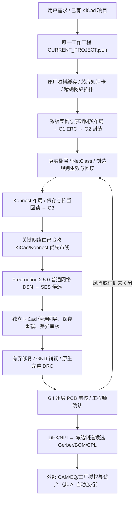

# KiCad PCB AI 工作流 · R10.0.0 七阶段受控布线

> **R10.0.0 软件稳定版发布目标（2026-11-18）**：基于已合并的 [PR #6](https://github.com/jackwang988/kicad-pcb-ai-workflow/pull/6)、[PR #7](https://github.com/jackwang988/kicad-pcb-ai-workflow/pull/7) 及 [GND 保护修复 PR #9](https://github.com/jackwang988/kicad-pcb-ai-workflow/pull/9)。原生 KiCad→Freerouting→SES→KiCad 保护测试已通过；正式 ZIP/标签须由 [稳定版 CI](.github/workflows/release-r10-stable.yml) 在 main 重新通过软件与原生测试后创建。**软件稳定≠任意PCB自动通过 G4 或授权投产。**
>
> **已验证范围**：KiCad 10.0.8 / Freerouting 2.5.0 隔离样板中，8条普通网络走线回导成功、GND新增走线为0（[原生测试](https://github.com/jackwang988/kicad-pcb-ai-workflow/actions/runs/44295612537)）；该样板仍有原生DRC 9项违规与2项未连接，**不能称为G4通过**。更复杂的多层/高速/电源产品必须独立验收。

[核对 R10 正式版 Release 与 ZIP/SHA](https://github.com/jackwang988/kicad-pcb-ai-workflow/releases) · [R10.0.0 说明](R10_STABLE_RELEASE_NOTES.md) · [当前源码](https://github.com/jackwang988/kicad-pcb-ai-workflow/tree/main/kicad-pcb-ai-workflow) · [16节点及七阶段完整流程图](docs/r10/06-current-skill-full-flow.md) · [布线工程契约](kicad-pcb-ai-workflow/references/freerouting-seven-stage.md) · [验收矩阵](docs/r10/05-release-readiness.md) · [R9.4历史包](dist/kicad-pcb-ai-workflow-R9.4.zip)

## 一、R10 核心架构



- **决策层**：AI结合需求、原厂资料、真实网络拓扑和工程规则生成受约束的操作计划；不能编造 datasheet、阻抗、层叠或通过结果。
- **执行层**：Konnect MCP是活动EDA工程的唯一受控写入者；动态发现实际能力，每次授权、写入、保存、回读和异常复核。Python负责只读解析、计算、规则/几何审计与证据绑定；KiCad原生CLI负责独立 ERC/DRC 与制造导出核验。
- **证据层**：器件卡片按制造商＋精确MPN＋封装缓存并复用于 G1/G2/G3/G4；单一权威 `01_WORKING` 工程、只读历史、不可覆盖里程碑、摘要阅读与完整本地审计证据同时保留。
- **门禁层**：任何未知网络、未生效规则、缺失工具、超出权限的改动、过期哈希或未关闭阻断问题均 `BLOCKED`；不能通过降低规则或删除对象制造通过状态。

## 二、16 节点工程全流程

| 节点 | 操作与真实产物 | 门禁 |
|---|---|---|
| 01–04 | 环境/工作区保护 → 量化需求与架构 → 原厂器件知识卡 → 0Ω/DNP/备用方案决策 | 输入来源与工程身份可追溯 |
| 05–07 | **先网络拓扑、预留布线通道及引脚空间，再摆放原理图器件** → 保存原生网络表/ERC → 符号封装脚号比对 | **G1 原理图，G2 封装** |
| 08 | 与板厂确认层叠、铜厚、线宽/线距、过孔、板边、差分/电源约束；在KiCad真实设置并回读 | 规则未生效不能布局/布线 |
| 09 | 连接器/安装孔锚定、模块布局、去耦与关键回路优化，Konnect保存及坐标回读 | **G3 仅布局专项审核**，允许飞线，**不做未布线全板DRC** |
| 10 | **关键网络优先 → Freerouting 普通网络 → SES回导 → 有界修复 → GND铺铜 → 原生DRC** | 七阶段布线契约及实际保存板审计 |
| 11 | 布线、过孔、参考地、回流路径、全部铜层、真实原生 DRC 和工程师确认 | **G4 最终PCB评审** |
| 12–13 | DFX/NPI → 独立冻结制造候选 → Gerber/Excellon/BOM/CPL/图纸及哈希 | `EXPORTED_NOT_RELEASED` |
| 14–16 | 工厂CAM/EQ与放行 → EVT/DVT/PVT → ECO归档 | **外部人工/实体流程**，不是AI自动执行或自动批准 |

详细输入/输出/失败回退：[最新全流程说明](kicad-pcb-ai-workflow/references/latest-complete-workflow.md)；[完整架构与实际运行流程图](docs/r10/06-current-skill-full-flow.md)。

## 三、PCB 七阶段布线执行标准（R10）

1. **完整网络清单**：依据保存的 KiCad PCB 和原生 XML Netlist 确定全部网络、`(Ref, Pin)` 端点、P0–P4 分类、电流、关键性、GND/NC，并检查真实 NetClass 归属。
2. **制造与设计规则先行**：取得板厂批准的层叠、铜厚、最小线宽/线距/过孔/板边，配置真实 NetClass、层限制、电源宽度、差分/等长及禁布区并重新读取验证。电源主干以实际电流/温升/压降计算和既定基准线宽为依据，额外保留**至少 0.254 mm 线宽余量**（不是统一固定宽度）；细脚仅允许经批准、有长度/区域上限的局部颈缩。
3. **关键网络优先并保护**：P0–P2等高优先级（高速/RF/差分/电源/Kelvin/时钟/开关回路）由已验收的 KiCad/Konnect 专项方式布线；保存、回读实际铜对象，保护原走线与锁定对象。
4. **Freerouting 2.5.0 批量普通网络**：保存 PCB 后导出 DSN，绑定 DSN/JAR 及获批准的 `.rules` SHA-256，使用 `-inc` 按**NetClass**排除 GND 与所有受保护网络类别；仅路由允许的普通 P3 网络，限制重试/时间/过孔，产生独立 `.ses` 候选。`-inc` 不是按网络名称排除；NetClass 必须确实覆盖全部网络。
5. **SES 导入与真实几何审核**：仅在隔离 KiCad 候选中经认可工具回导，保存/重载，对比网络、封装位置、原有关键铜与对象UUID，审核普通网络线宽、层、过孔、H/V/45°走线及完整性。**生成 SES 不等于成功布线。**
6. **有界修复**：仅处理明确的未连接项或获准的拆线白名单；执行前确认范围/限额，改动后重复真实回读；失败或工具缺失则阻断并交由工程师处理，不默认放宽工艺/电气规则。
7. **GND 首次铺铜 → 检查地铜连通 → 按需补地孔 → 再次铺铜 → 全板 DRC/G4**：GND不参与普通走线。先在批准的GND铜层真实覆铜并保存，审核孤岛、焊盘、回流路径和跨层铜区；仅在必要、合法且经批准的位置放置GND缝合过孔（并非见空白就打孔），**之后重新填铜、保存重载**。四份PCB快照通过只读 `pcb.ground_plane_audit`，才能执行 `kicad-cli pcb drc --refill-zones --save-board` 全板DRC与未连接检查。DRC不为零继续修复并再次覆铜；G4工程师签核独立。**铺铜前GND飞线不是最终DRC故障。**

[GND 铺铜、跨层地孔与 DRC 前置门禁规范](kicad-pcb-ai-workflow/references/gnd-before-drc.md)。GND 有多层填充不自动证明各层互连，最终须检查实际接触和原生网络连通性。

**注意**：Freerouting 2.5.0 不保证自动满足任意 KiCad 自定义 DRC、受控阻抗/等长/回流/局部颈缩，也不能仅凭 DSN/SES 证明最终角度45°；由导入后的实际铜和原生检查判定。审核脚本**只读**，不会自行执行 SES 导入、GND铺铜或原生DRC。

[七阶段详细参数与命令](kicad-pcb-ai-workflow/references/freerouting-seven-stage.md) · [主次布线与 NetClass 技术边界](kicad-pcb-ai-workflow/references/freerouting-primary-routing.md) · [设计约束](kicad-pcb-ai-workflow/references/constraint-routing.md)

## 四、部署与示例命令

**实际 Skill 位于仓库内的 [`kicad-pcb-ai-workflow/` 子目录](kicad-pcb-ai-workflow/)**，只安装这一层（包含 `SKILL.md`、`scripts/`、`references/`、`assets/`）。仓库根目录不是Skill安装目录。

- **使用R10当前源码**：`git clone https://github.com/jackwang988/kicad-pcb-ai-workflow.git`，再将仓库内部的 `kicad-pcb-ai-workflow/` 目录安装到 Agent Skills 目录。更新时以新目录完整替换、核对文件和原工程备份，勿与旧脚本混装。
- **已有正式包**：[R9.4稳定包](dist/kicad-pcb-ai-workflow-R9.4.zip)和 [R10.0.0-rc.1历史预发布包](dist/kicad-pcb-ai-workflow-R10.0.0-rc.1.zip)不包含本次全部合并改动；**不要当作最新版七阶段布线包**。
- **环境依赖**：匹配版本的 KiCad CLI/原生工程、可用的 Konnect MCP，普通网络自动布线还需要经SHA验证的 Freerouting **2.5.0 JAR** 和 Java，以及明确批准的厂规。Konnect/Freerouting为独立外部工具，不随Skill自动安装。`jsonschema>=4.18,<5` 见 [requirements.txt](requirements.txt)。
- **版本**：KiCad 10.0.7为历史推荐基线；KiCad 10.0.8曾完成独立原生工具链烟测。其它10.x必须实际验证能力；KiCad 9尚未开放未经验证的原生生产能力；KiCad 11+的CLI-only候选不等于PCB写入适配。

在Skill目录中以本机正确Python解释器运行，先预览、核对目标工程，再按需 `--apply`：

```bash
python scripts/workflow.py run /path/project --task environment.doctor
python scripts/workflow.py workspace /path/project --action status
python scripts/workflow.py status /path/project --bundle control-r1 --format compact
python scripts/workflow.py modules --intent pcb
python scripts/routing_seven_stage.py plan /path/project --config route-plan-config.json
# 仅在取得真实DSN/NetClass及厂规审核后运行候选
python scripts/freerouting_adapter.py --dsn route/board.dsn \
  --expected-dsn-sha256 ACTUAL_DSN_SHA \
  --netclass-map route/netclass-map.json \
  --expected-netclass-map-sha256 APPROVED_NATIVE_MAP_SHA \
  --jar approved/freerouting-2.5.0.jar \
  --expected-jar-sha256 APPROVED_JAR_SHA \
  --exclude-netclasses GND,DIFF_CRITICAL,RF_CRITICAL,POWER_CRITICAL \
  --output-dir NEW_CANDIDATE --passes 20
# 真实SES须在独立KiCad/Konnect工程中导入、保存、重载，再审计：
python scripts/routing_seven_stage.py audit-import /path/project --config route-import-config.json
# Konnect 在保存的 PCB 上先实际铺GND → 如需则添加已批准地孔 → 再次铺铜和保存重载。
python scripts/routing_seven_stage.py audit-ground /path/project --config ground-config.json --output reports/ground-pre-drc.json
# 只有审核通过，才能对完成铺铜的候选板运行全板 DRC：
kicad-cli pcb drc --refill-zones --save-board --format json --output reports/final-drc.json /path/project/checkpoints/final-refilled.kicad_pcb
# 再次保存回读，最后用 ground gate、post-DRC board 与 DRC report 的 SHA 审核：
python scripts/routing_seven_stage.py audit-final /path/project --config route-final-config.json
```

以上 Freerouting 命令默认仅生成预览，参数值和类名是示例，实际批准后再执行 `--apply`；如有 `.rules` 还必须显式给出其路径和SHA。参考 [环境配置](kicad-pcb-ai-workflow/references/environment-onboarding.md)、[工作区保护](kicad-pcb-ai-workflow/references/workspace-and-token-policy.md) 与 [模块化执行说明](kicad-pcb-ai-workflow/references/module-pcb.md)。

## 五、软件验收、原生验收与制造边界

| 层级 | 截至 2026-11-18 的状态 |
|---|---|
| PR #6 软件 CI | [已通过](https://github.com/jackwang988/kicad-pcb-ai-workflow/actions/runs/44278478257) |
| PR #7 软件 CI | [已通过](https://github.com/jackwang988/kicad-pcb-ai-workflow/actions/runs/44287952061) |
| KiCad 10.0.8 基础原生工具链 | [历史隔离工程烟测通过](https://github.com/jackwang988/kicad-pcb-ai-workflow/actions/runs/44015065144)，不等于新路由全链通过 |
| Windows/Konnect 本机 | **维护者报告已验收通过**；当前仓库没有相应的新现场日志/录屏可供独立复核 |
| KiCad→Freerouting 2.5.0→SES→KiCad 原生往返 | **PASS_NOT_G4**：[#44295612537](https://github.com/jackwang988/kicad-pcb-ai-workflow/actions/runs/44295612537)。GND在真实DSN中归属GND类；禁用v2.5.0 Fanout/Optimizer后，KiCad回导保存得到8条普通网线、0条新增GND铜线；旧版路由夹具在未铺地铜时出现过9项违规与2项未连；**不属于G4判定**。路由互通夹具已停止铺铜前全板DRC |
| 不同层数/高速与电源混合项目、CAM/试产 | 未作为自动化通用能力认证；每个真实产品需独立验收 |

**修复记录（[PR #9](https://github.com/jackwang988/kicad-pcb-ai-workflow/pull/9) / [Issue #8](https://github.com/jackwang988/kicad-pcb-ai-workflow/issues/8)）**：仅有 NetClass 名称声明不够；必须校验网络实际 DSN 类成员与独立原生 `net_to_class` 全量映射及SHA-256。Freerouting 2.5.0 的 Fanout/Optimizer 在先前测试中绕开了GND保护，因此 R10普通网批量布线默认关闭这两阶段；回导后的受保护铜线差异审核继续强制执行。支持范围外保持 BLOCKED。

**软件发布不等于 PCB 可投产授权。** 源码测试、保存板上的G4 DRC、工程师的电气/热/高速审核以及板厂CAM/EQ/样机测试是独立步骤。Gerber、钻孔、BOM、CPL 导出成功仍标记 `EXPORTED_NOT_RELEASED`。

## 六、更多说明

[R10当前系统全流程与架构图](docs/r10/06-current-skill-full-flow.md) · [R10文档导航](docs/r10/README.md) · [原厂推荐电路与器件卡](kicad-pcb-ai-workflow/references/device-knowledge.md) · [原理图预布局门禁](kicad-pcb-ai-workflow/references/schematic-preplacement.md) · [G3布局规则](kicad-pcb-ai-workflow/references/placement-quality.md) · [DFX/NPI](kicad-pcb-ai-workflow/references/dfx-npi.md) · [能力与限制](kicad-pcb-ai-workflow/references/capabilities.md) · [MIT](LICENSE)

作者：[Jack](https://github.com/jackwang988) · 许可证：MIT。