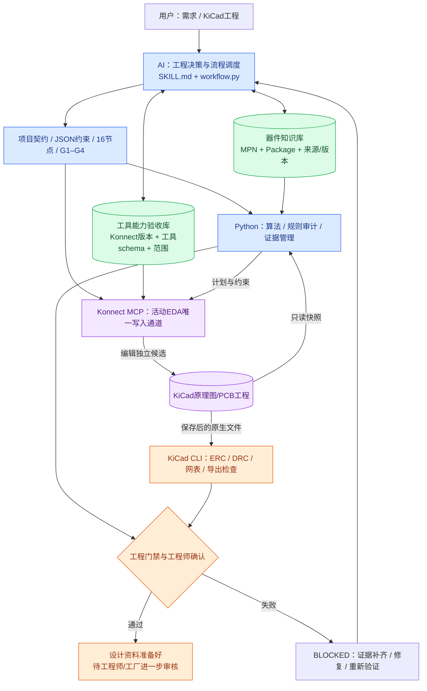

# R10 · 系统总体架构

[返回R10导航](README.md) · [16节点](02-16-node-workflow.md) · [验收状态](05-release-readiness.md)

## 四种职责不能混淆

| 主体 | 工作 | 不负责 |
|---|---|---|
| AI | 阅读需求、选择方案、解释风险、编排已登记的操作 | 伪造实验数据或自行替工程师批准 |
| Python | 知识卡索引、规则计算、布局/布线候选、哈希/证据审计 | 默认直接修改活动中的KiCad文件 |
| Konnect MCP | 动态发现工具、受控执行实时EDA写入、保存/回读 | 未验收就假定复杂任务一定可靠 |
| KiCad原生CLI | ERC/DRC、网表、制造文件和原生工程检查 | 代替信号/电源完整性工程判断 |

## 一份工程一个写入者

任何时候只授权一个活动EDA写入后端。旧 `pcbnew` 部分只读适配仍可能存在于迁移版里；只有完成等价验证，才可移除。离线冻结步骤需要先保存、交接、独立候选、原生复验；不能让GUI、MCP和其他脚本同时写同一个工程。

原厂知识卡和工具能力记录**可以跨项目复用**；所有项目中的**真实修改结果必须逐次验证**。
