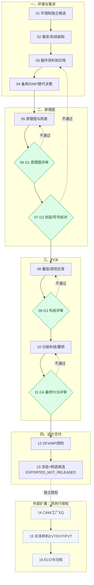
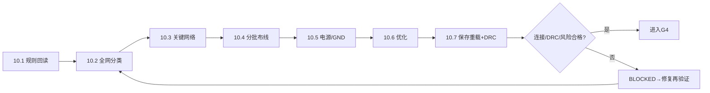

# R10 · 16节点完整主线与处理规则

[返回R10导航](README.md) · [系统总架构](01-system-architecture.md)

> **节点01–13为AI设计主线**；14–16是外部工厂与实际研发流程的扩展，不能当作AI已自动完成的生产活动。

## 各节点：输入 → 处理 → 验证/输出

| 节点 | 输入和处理方法 | 通过条件或回退 |
|---|---|---|
| **01 环境检查** | 查KiCad/CLI、Konnect连接、版本与目标工程；建立独立候选，不直接覆盖原工程 | 工具/工程身份不符→BLOCKED；记录环境和能力边界 |
| **02 需求/架构** | 输入产品功能、供电、电流、接口、尺寸、成本、环境；建立系统框图、网络/电源树、验收矩阵 | 每个关键要求有来源与可执行验收法 |
| **03 器件知识库** | 先按厂家+精确MPN+封装查询已审核卡；命中复用、缺失才查原厂，登记版本/哈希/适用条件 | 身份错误、过期或证据缺失→补卡/核对；冻结当前项目卡片 |
| **04 备用决策** | 判断0Ω、DNP、替代MPN、测试点、可调试性及互斥装配变体 | 保留/不保留都有理由，BOM及变体一致 |
| **05 原理图** | 根据拓扑、接口和资料建立原理图、网络及设计意图，实际操作KiCad候选 | 原生文件能打开、网络真实存在、网表一致 |
| **06 G1评审** | 从节点3知识卡读取电源、复位、启动、时钟、推荐电路；对照当前连接+原生ERC | AI报告+原生ERC+工程师对当前版本确认，不通过返05/03 |
| **07 G2封装** | 复用Pinout/Land Pattern卡，检查符号引脚→焊盘号、EP、极性及资源锁 | 实际器件映射完整，卡片不等于封装自动合格 |
| **08 PCB规则** | 固定叠层、工艺线宽/间距、钻孔/孔环、阻抗、NetClass、差分规则 | 必须在真实KiCad工程回读规则，不只看JSON |
| **09 G3布局** | 复用晶振/去耦/RF/供电局部布局卡；检查实际器件、焊盘坐标、回流、通道 | 关键局部约束通过；仅有知识卡不能代替实板布局审核 |
| **10 PCB布线** | 规则预检→网络分类→关键网→普通网→电源地→优化→保存重载 | 单一Konnect写入；执行范围须经能力验收，原生连通/DRC检查 |
| **11 G4 PCB评审** | 复用高速/RF/电源/布局知识，逐层审查当前走线、参考地、铜皮、过孔和回流 | 独立DRC、AI评审、工程师签核；不合格返10/09 |
| **12 DFX/NPI** | 校验制造公差、装配、BOM/CPL、DNP、丝印、测试可达性及各门禁证据 | 必需证据完整，关键风险关闭 |
| **13 制造候选** | 冻结候选；导出Gerber、钻孔、BOM、CPL等；建立哈希和文件清单 | 只到 `EXPORTED_NOT_RELEASED`，**不是**生产批准 |
| **14 CAM/EQ** | 工厂CAM检查、工程问题澄清、授权 | 外部工厂和工程师处理；不由AI直接放行 |
| **15 样机** | 真实上电、功能/温升/EMC等适用测试 | 必须有实际硬件与测试证据 |
| **16 ECO** | 修改原因、受影响路径、回归测试、重新冻结、版本归档 | 新旧版本和制造资料可追溯，按影响重做G1–G4 |

## 节点10的七步布线闭环

特别说明：A*路径搜索是离线候选算法，不等于写入了PCB；GND覆铜并不自动证明回流完整。未知Konnect功能要进行专项能力测试，不得静默降级成未经验证的旧写入后端。
