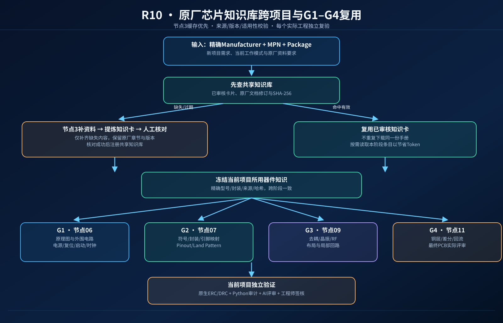
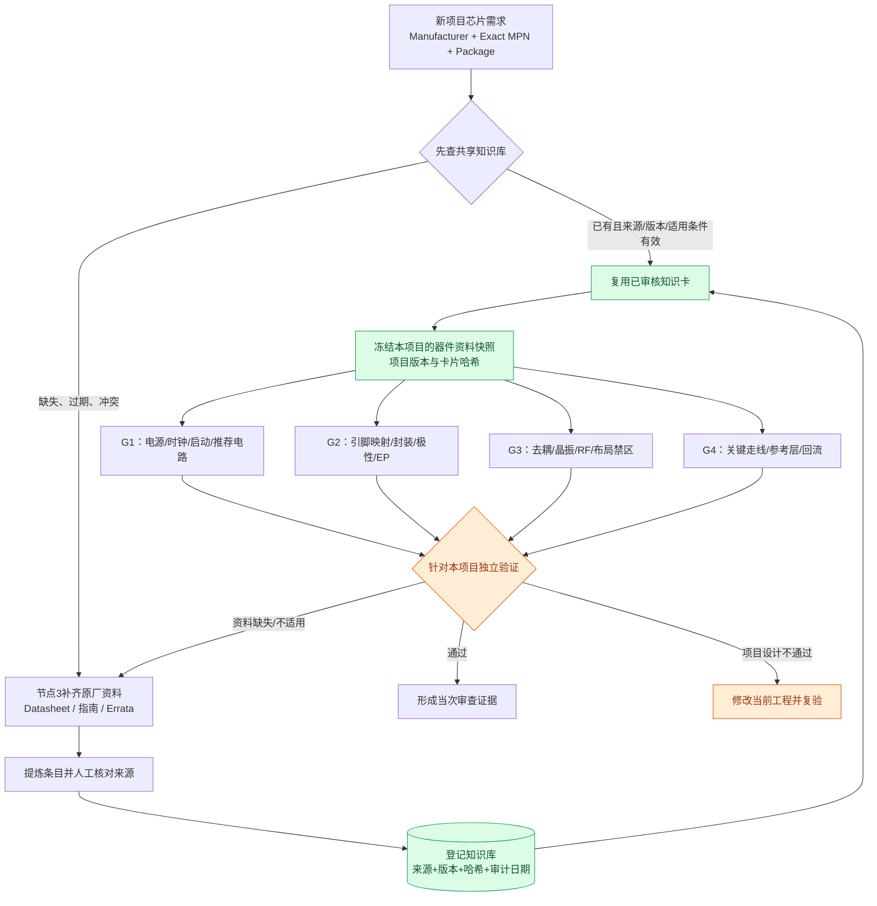

# R10 · 芯片知识库跨项目、跨G1–G4复用

[返回导航](README.md) · [16节点](02-16-node-workflow.md)

## 知识卡必须有什么

- 器件身份：制造商、**精确型号（MPN）**、封装和必要的子型号。
- 原厂来源：文档名称、修订版本、获取日期、SHA-256及章节/页码定位。
- 适用条件：电源范围、接口配置、温度等级、工作模式及板层/叠层前提。
- G1：供电、EN/RESET/BOOT、时钟、推荐外围电路。
- G2：引脚编号/功能/封装、land pattern、裸焊盘与装配提示。
- G3：去耦回路、晶振/RF布局、热与结构禁区。
- G4：回流/参考层/高速规则、关键电源和差分链路约束。
- 不确定项：仅存资料无法证明的条件，标注为“待查证”，绝不补猜。

**节省Token的正确方法**：AI默认读取本节点相关的精简卡片，而不是重复全文提取PDF；当遇到复杂图表、修订冲突、特殊工况或证据不足时，仍要打开已保存的原厂原文核对。缓存命中只证明知识可用，不代表新原理图/PCB合格。
