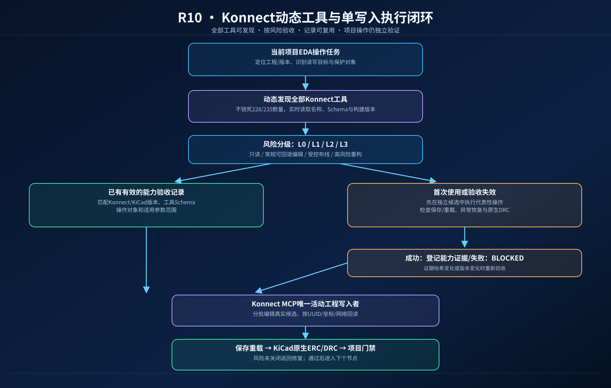
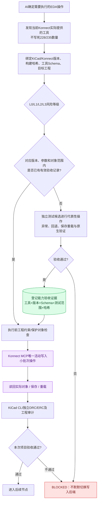

# R10 · Konnect工具动态发现与单写入执行闭环

[返回导航](README.md) · [系统架构](01-system-architecture.md)

## 四级操作风险

| 级别 | 操作 | 首次使用及复用 |
|---|---|---|
| L0 | 读版本、查工具、读器件和规则 | 查连接/工程身份后可读取 |
| L1 | 可恢复的单器件移动/旋转/丝印 | 代表性候选操作+回读；有效验收范围内复用 |
| L2 | 多器件布局、走线、过孔、覆铜、网络写入 | 先专项能力测试，保护对象、分批执行、原生检查 |
| L3 | 大规模重布局、删除、整板自动布线和复杂重构 | 独立候选+异常/回退测试+严格复验与审批 |

## 能力验收库 ≠ 工程合格证

记录必须至少绑定：Konnect构建、KiCad版本、工具名称、入参结构、操作对象/参数范围、测试工程及证据哈希。更新版本、schema或条件变化可能使记录失效。

统一写入只是编辑约束；真正的工程质量仍依赖**当前板的**网表、几何、ERC/DRC、AI评审和人工签核。允许的工具多，不代表自动放行的操作多。

## 迁移未完成事项

- 旧 `pcbnew` 的覆铜/保存写入不再作为默认可用路径；必须证明Konnect等价完成并在候选板复验。
- 部分NetClass、制造几何和高速审计仍有传统pcbnew**只读**兼容依赖，须逐项迁移。
- 本地33项离线软件测试不等价于真实Konnect/KiCad完整工程验收。
