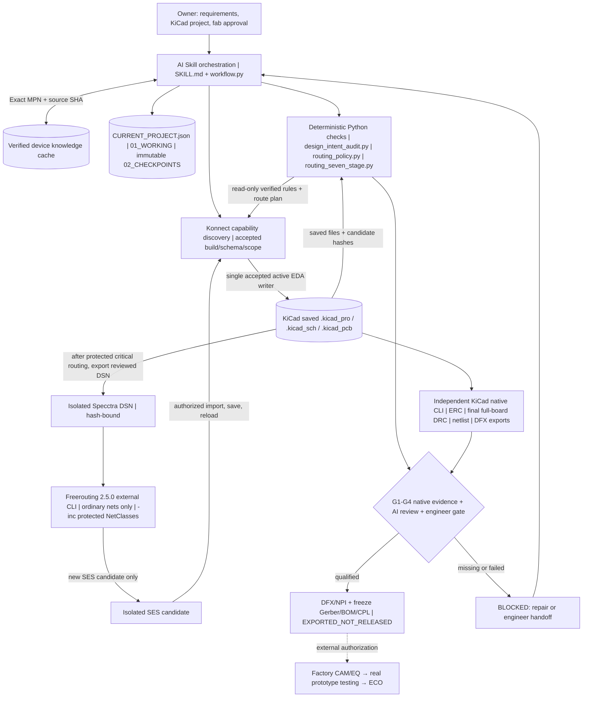
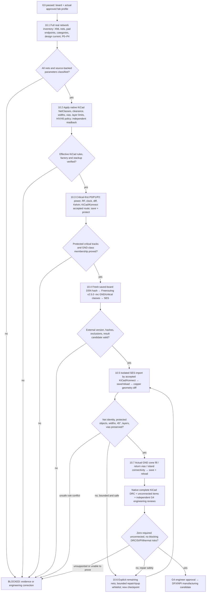

# R10 Current Skill: Complete Architecture, 16-Node Execution and Seven-Stage Freerouting

> **Current development branch:** `feat/r10-freerouting-primary-gated-20261118`. These diagrams reflect the actual R10 candidate sources, including `SKILL.md`, `workflow.py`, `routing_policy.py`, `routing_seven_stage.py` and `freerouting_adapter.py`. **The seven-stage planner and copper auditor are implemented read-only, while automatic SES import, native G4 execution orchestration and a complete live Konnect/Freerouting round-trip are still subject to integration acceptance.** Do not interpret a diagram as a completed runtime capability.

## Diagram 1 — System execution architecture

**Separation of authority:** AI chooses and verifies the engineering plan; Python plans/audits without modifying active EDA; Freerouting generates **offline routing candidates**; Konnect is the accepted single active KiCad writer; KiCad CLI provides independent native evidence. No success marker may bypass an engineer's project-specific approval.

## Diagram 2 — End-to-end 16-node product-design flow

```mermaid
flowchart TB
  N01["01 Environment + single working project"] --> N02["02 Requirements / block diagram / power tree"]
  N02 --> N03["03 Manufacturer evidence / exact MPN knowledge cache"]
  N03 --> N04["04 0R/DNP/alternatives/assembly decisions"]
  N04 --> N05["05 Schematic: topology → channels → symbol placement → real wiring"]
  N05 --> G1{"06 G1: saved ERC + schematic/source review"}
  G1 -->|pass| G2{"07 G2: pin-to-pad, footprint, library resource locks"}
  G1 -->|fail| N05
  G2 -->|pass| N08["08 Factory profile approved; actual stackup/NetClasses/rules applied & read back"]
  G2 -->|fail| N03
  N08 --> N09["09 G3: constrained PCB placement; Konnect save + positions readback"]
  N09 --> G3{"G3: Courtyard + mechanical + layout-only verification"}
  G3 -->|fail| N09
  G3 -->|pass; unrouted nets allowed| N10["10 Seven-stage routing / Freerouting ordinary candidate / zone fill"]
  N10 --> G4{"11 G4: all required nets connected, native DRC + SI/PI/thermal + engineer"}
  G4 -->|fail| N10
  G4 -->|pass| N12["12 DFX/NPI fabrication + assembly reviews"]
  N12 --> N13["13 Immutable manufacturing candidate + SHA manifest"]
  N13 --> E["EXPORTED_NOT_RELEASED: output only, not production approval"]
  E -. "separate external authorization" .-> N14["14 Factory CAM & engineering questions"]
  N14 -. "physical board exists" .-> N15["15 EVT/DVT/PVT / thermal / EMC / functional tests"]
  N15 -. "authorized change request" .-> N16["16 ECO / change impact / new revision"]
```

**Important G3/G4 boundary:** After G3 layout and before routing, missing connections are expected. **Do not run full-board DRC as a G3 approval criterion.** The full native KiCad DRC, including unconnected items, belongs after routing and actual GND refill at G4.

## Diagram 3 — Node 10: actual seven-stage routing contract

## Diagram 4 — Exact current implementation boundary

```mermaid
flowchart LR
  A["routing_policy.py | hashed full-net preflight"] --> B["routing_seven_stage.py plan | protected/ordinary class split"]
  B --> C["freerouting_adapter.py | -inc + hash-locked DSN/rules/JAR"]
  C --> D["SES candidate | NOT PCB copper"]
  D --> E["External accepted Konnect/KiCad SES import, save, readback | integration work"]
  E --> F["routing_seven_stage.py audit-import | limited saved-board copper diff"]
  F --> G["Native KiCad zone refill + full DRC | external action"]
  G --> H["routing_seven_stage.py audit-final | verifies supplied native DRC JSON + saved geometry"]
  H --> I["G4 independent project review | approval separate"]
```

| Component | Current R10 branch scope | Acceptance boundary |
|---|---|---|
| `CURRENT_PROJECT.json`, `workflow.py` | Single authoritative project, checkpoints, task routing, stage approvals | Native edit & release need independent receipts |
| `device_knowledge.py`, source cards | Manufacturer/source cache and G1–G4 reuse | Each exact project still reviewed |
| `schematic_*.py`, `schematic_style.py` | Topology/geometry preflight, composition and static checks | Automatic native schematic editor not proven generically |
| `design_intent.py`, `pcb_fab_approval.py` | Approved fab profile / rule proposals and native-readback check interfaces | Actual Konnect rule application and user confirmation mandatory |
| `pcb_module_layout.py`, `placement_review.py` | Rules-first layout plan, Courtyard and G3 placement-only audit | Real positions via Konnect + save/readback |
| `routing_policy.py` | Full-net, power width +0.254 mm, stackup/geometry/accepted backend read-only guards | Not a track engine |
| `routing_seven_stage.py` | Seven-step plan; imported/final saved-board limited track/angle/via/GND/DRC JSON checks | Not native KiCad import, full DRC executor or G4 approver |
| `freerouting_adapter.py` | Exact 2.5.0 DSN→SES *offline* CLI candidate, version/hash/exclusion isolation | SES must be imported/verified separately |
| `konnect_capabilities.py` and MCP | Scope/risk-bound active EDA operations | No undocumented stable GUI API guarantee |
| `static_review.py`, `manufacturing_export.py` | Independent G4 review and isolated output process | `EXPORTED_NOT_RELEASED`, no fictitious factory approval |

## Validation matrix: software versus real native / full integration

| Test tier | Required evidence | What may be claimed |
|---|---|---|
| A. Software regression | GitHub workflow Python tests with reproducible commit SHA | Code-level contracts only |
| B. Native KiCad | Actual installed version + real `kicad-cli` and `pcbnew`, saved board, DRC and outputs | Exact test-environment native capability only |
| C. Freerouting executable | Official pinned 2.5.0 JAR/checksum, real DSN input and nonempty SES with run log | External route candidate generation only |
| D. KiCad ↔ Freerouting round trip | Actual DSN export + SES import to independent board, saved/reloaded copper, protected geometry comparison and full DRC | Exact fixture integration only |
| E. Windows / live Konnect end-to-end | Actual Windows KiCad 10.0.8, Konnect dynamic tools, true GUI save/readback, multiproject test matrix | Only after recorded live acceptance; never inferred from CI |
| F. Production engineering | SI/PI/thermal/DFM/DFT and G4 engineer approval, manufacture/equipment evidence | Still cannot replace CAM/factory EQ and physical EVT |

**Do not mark tier D or E passed solely from A/B/C.** When a test is unavailable or fails, preserve the failed evidence and keep the runtime scoped to already verified functions rather than weakening rule gates.

See also [Skill routing spec](../../kicad-pcb-ai-workflow/references/freerouting-seven-stage.md), [native rule contract](../../kicad-pcb-ai-workflow/references/constraint-routing.md), [R10 migration readiness](05-release-readiness.md), and [16-node legacy diagram](02-16-node-workflow.md).
