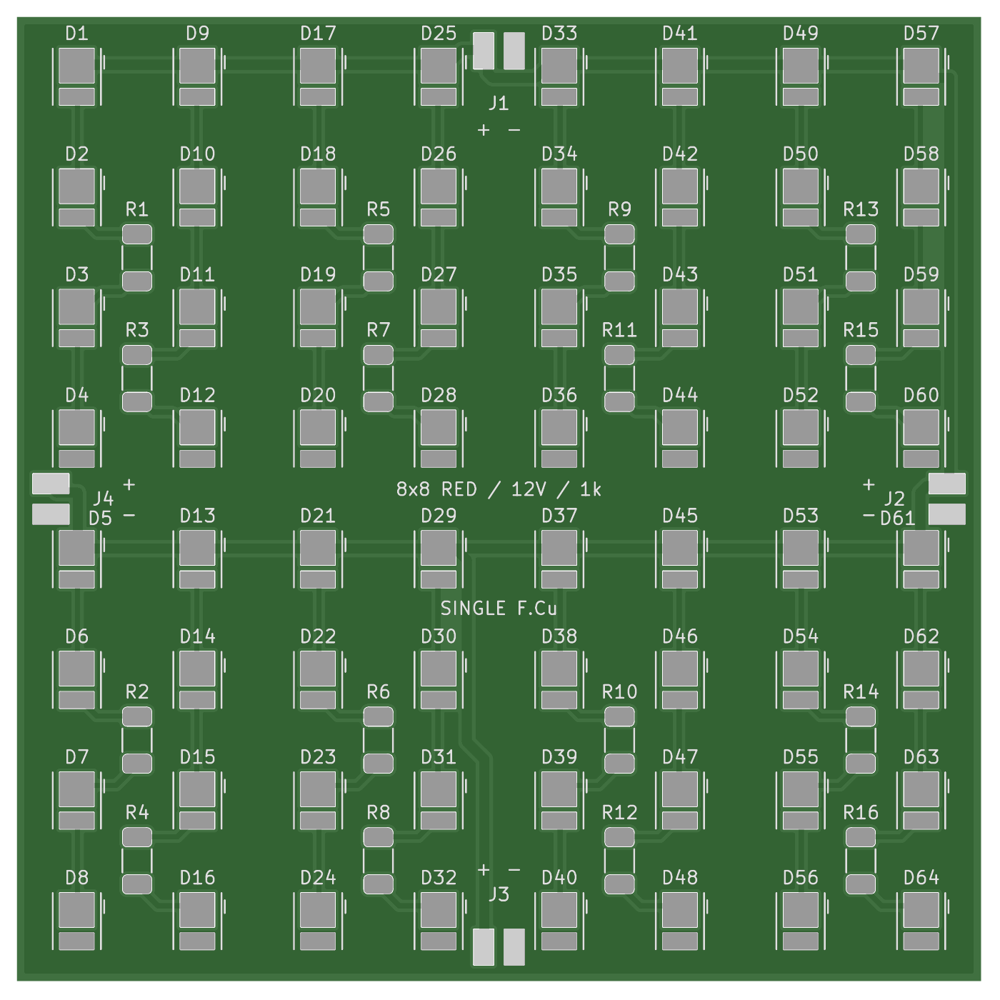

# R10.0.2：本机 LED 全链路实测与丝印修复经验

2026-11-21，Windows x86_64 / KiCad 10.0.8。一块板的 CAD 主线已经跑通：需求与器件资料 → 原理图 → PCB → 原生 ERC/DRC → Gerber/BOM 工程导出。**最终 ERC/DRC 均为 0 错误、0 警告、0 未连接。** 这不是“全部 16 节点、所有板型和所有电脑已实测完成”。

[源板与原始证据](../../development/fixtures/led-8x8-12v) · [本机观察矩阵](../../development/fixtures/led-8x8-12v/evidence/observed-validation.json) · [独立原生复核脚本](../../development/native_led_8x8_e2e.py) · [开源 MCP 补丁](../../development/konnect-field-extension)

## 1. 板子的实际范围

60×60 mm；64 颗红光 2835 LED，8×8、中心距 7.5 mm、边缘灯中心距板边 3.75 mm；正面、统一极性；16 路并联，每路 4 颗串联 LED 与一颗 1 kΩ / 1% / 1206 / 0.25 W 电阻。4 组边缘中点附近的供电焊盘允许内移。仅 F.Cu 实体铜层，205 段走线、1 块 GND 覆铜、0 过孔、0 钻孔。

LED 使用已核对脚号/焊盘的 Wurth Elektronik 150283RS73103，pin 1=A、pin 2=K。所有灯保持阳极朝上、阴极朝下。电阻分布在相邻列的行间。此低电流流程验证设计约为每串 4 mA；亮度、电流与热性能尚未通电测量。不能把“2835”封装直接当作任意颜色/Vf 的可替代料号。电阻厂牌/MPN 未选定，BOM 按规格列出。FR-4 / 1.6 mm / 35 μm 是设计标称，尚非板厂接受记录。

## 2. 已实测与未实测

| 环节 | 真实结果 | 仍有的边界 |
|---|---|---|
| MCP 连接/版本/工程身份 | 实际运行版本、IPC 端点和唯一目标板核对；Python 编排 stdio MCP | 已配置的版本不等于正在服务的版本；未证明新电脑一键安装 |
| 需求、资料、符号与封装 | 原厂引脚/推荐焊盘、独立支路拓扑；项目自定义库 | 不是所有芯片/封装通用验收 |
| 原理图 | 84 个实际器件符号，独立 66 网络端点分组；原生 ERC 0/0 | 正式 G1/G2 工程师签名未登记 |
| PCB 放置/走线/铺铜 | MCP 写入与保存回读；205 段正面走线、0 过孔；GND 覆铜连通 | 本 LED 板未用 Freerouting DSN/SES；其他 CI 的互通样板是另一层证据 |
| 丝印与字段 | 279 条警告全部清零；84 个可见位号与 376 个字段值核对 | 依赖本地编译的开源 Konnect 字段扩展，官方 0.14.1 不直接具备 |
| 最终原生检查 | ERC/DRC 0 错误/0 警告/0 未连接，规则严重级别与排除项未改 | 原生零违规不等于正式 G4 签字、EMC/热/SI 全验证 |
| Gerber/BOM | MCP 导出；独立解析、几何比对、实际 Gerber 预览和 ZIP/哈希核验 | 使用工程快照；未跑 `freeze_candidate.py` 正式交接/终结门禁；未验收 CPL 贴装交付 |
| 原生回归脚本 | 新副本重新 ERC/DRC、网络、Gerber/BOM；保留源文件哈希 | 是已保存设计的复核，不是新机器重放全部现场 MCP 创建/编辑操作 |
| 板厂/实物 | 资料状态 `EXPORTED_NOT_RELEASED` | CAM/EQ、正式投产、EVT/DVT/PVT、通电/亮度/热测试未做 |

因此“稳定维护版”的依据是软件回归、已公开的单板实测和明确能力边界；不能写成“通用全自动 PCB 量产工具”。

## 3. 运行中真正有用的经验

### 先确认正在运行的工具，而非安装目录

运行时曾仍是 0.13.0，而 Skill 默认配置已指向较新版本；连接器的 IPC 参数也不一定等于本机真实端点。每次以 `get_installation_info`、实际 schemas 和当前工程身份为准。配置应由本机生成，公开包不携带个人路径、IPC 配置、日志或二进制。

一次授权且范围清楚的操作完成后继续后续必要工作；有界第一笔写入保存并回读即可，不给每个普通字段修改额外制造一轮授权。未知工具能力和不确定写入状态仍必须先核实。

### 原理图与 PCB 分别预留文字空间

先验证支路端点，再规划原理图器件/引脚/文字/连线空间；PCB 的 body/courtyard 预留不等于 reference 文字预留。通过同一工作工程持续修改，避免每轮产生“最新副本”争议。最终必须看原生图，不能仅根据规划 JSON 判断排版正确。

### 电气 DRC 通过不是全部 DRC 通过

最初电气检查已为 0 错误、0 未连接，但仍有 **135 丝印压焊盘 + 64 丝印重叠 + 80 字段不同步 = 279 警告**。这些警告必须保留并继续修复，不能把“走通了”写成“最终零违规”。

### GND 与板边问题要读真实规则

真正填铜后再审核回流/孤岛；不要把铺铜前的 GND 飞线作为最终失败，也不要把 GND 当普通 A* 网络继续加线。本例的边缘供电焊盘内移后，外侧 GND 回流才满足实际有效规则。原生铜到板边规则与口头设计假设可能不同，应读取实际值。`refill_zones` 成功返回后，保存仍可能收到 `AS_BUSY`：等 native 状态可响应再保存，不能把整个修改批次重新执行。

### 保存会影响项目规则的有效性

当前某些 MCP 规则工具直接编辑项目文件，GUI 的缓存随后可能在 SaveProject 时覆盖它。最后一次保存后重新读取实际规则并运行原生检查；以哈希绑定导出快照。这个快照通过检查，不表示后续任意 GUI 保存仍保持相同规则，继续设计前应解决缓存/重载问题。

## 4. 丝印问题是怎样解决的

| 问题 | 无效或不完整的做法 | 本次实际做法 |
|---|---|---|
| 位号压焊盘/压封装线 | 再次刷新封装库；更新库 reference 坐标 | 修改**板上实例字段**；保留器件与焊盘位置 |
| 缺 MPN/规格 | 看到原理图同步 dry-run `noop` 就认为字段已一致 | 枚举真实字段并按原理图逐项核对 |
| 同步后仍有字段警告 | 假设 80 个字段已全部修完，或只减计数 | KiCad 每器件可能只报首个差异；继续检查 Datasheet/Description |
| 规则排列仍有两处压焊盘 | 再次移动已经走通的连接器/铜线 | 单独给 D5、D61 位号向内避让邻近供电焊盘 |
| 新位号与说明相碰 | 隐藏说明、位号或极性标记 | 按精确 UUID 移动两条板面说明，保留 8 个正负极标记 |

现场核对发现官方 Konnect 0.13.0 和 0.14.1 的 `edit_component` schema 只有 value；`update_pcb_from_schematic` 未完成这些字段的实际同步，库刷新又保留实例文字。使用 Python/pcbnew 直接写板会破坏单写入者约束，因此补充了**开源 0.13.0** 的 `set_placed_footprint_fields` MCP 工具；没有改写或反编译商业 0.14.1。

接口默认 dry-run，revision 绑定实际前像和修改参数；apply 校验 revision 后，在一个可撤销提交中更新父封装，并比较所有非字段 protobuf 内容及所有字段的真实回读。先用 D1 做一笔、保存、原生 DRC 与几何比对，再批量扩展。3 项隔离 Rust 保护测试通过。每次源码/二进制哈希变化后重新验证相关能力，没有沿用旧版测试假装新版已验收。

实际修改：84 个位号，0.8 mm 字高、0.12 mm 笔宽、正向可见；208 个自定义字段值加 168 个 Datasheet/Description 值，共 376。D5/D61 的坐标是本板的局部例外，不可作为所有矩阵板规则。原生保存审计保留器件、焊盘、网络、205 段走线和填铜；允许序列化容差 2 nm，实际比较无数值差异。**没有通过隐藏字段、删除原理图字段、关闭检查或增加排除项消除警告。**

公开 companion 包含原始开源 ZIP/文件哈希、完整新增 Rust 模块、准备器和 AGPL 许可。它不自动注册/替换 MCP；新用户需要构建、明确本地登记、发现实际 schema 并做项目首次验收。现有官方 0.14.1 的用户应得到具体的“placed-field 能力缺失”结果，不能得到虚假的自动修复成功。

## 5. Gerber/BOM 的几个容易误交付点

单面实物不等于 KiCad 只保留一个逻辑层。本例 `.gbrjob` 自动写入两层、60.05 mm 图形包围盒以及默认 NetClass 部分参数；因此只保留作原始记录，不进入单面制板 ZIP。实际单面包使用显式 F.Cu / F.Mask / F.SilkS / Edge.Cuts，附 F.Paste；**60×60 mm 是闭合板框中心线**，0.05 mm 绘图笔宽使外包围盒为 60.05 mm。0 孔板原生输出的两个空钻孔文件也留在原始记录中。

当前通用 `manufacturing_export.py` 仍选择全部逻辑铜层及前后阻焊，**不能直接当作这个单面包的已验收导出路径**。本例用实际发现的 MCP `export_gerber` 显式选层并验证，正式制造器的单面层策略仍是未覆盖能力。工程资料导出与正式制造门禁分开记录。

采购 BOM 只有 64 LED + 16 R 共 80 颗；J1–J4 是 4 组板上焊盘，不是 4 个待采购连接器。原生完整 BOM 保留 84 个参考标号；铜/阻焊共 168 个焊盘/开窗，钢网只有 160 个开口。电阻 MPN 空缺如实保留，不能编造 LCSC/厂牌。BOM 显式导出 MPN/Manufacturer/Specification/Datasheet，避免 CLI 默认列漏字段。

实际 Gerber 独立解析后，逐焊盘位置与包围尺寸、逐走线端点/线宽、闭合板框、mask/paste 数量核对，并生成上述预览。RoundRect 多余参数及空钻孔 G90 的解析器警告有单独说明，不冒充原生 DRC 违规，也不直接屏蔽所有警告。原生回归报告应逐项列明覆盖与未覆盖：例如“覆铜区域数量”不等于“所有填铜多边形形状完全证明”，自动生成 PNG 也不等于板厂 CAM 签字。

## 6. 新电脑复核与分享建议

下载正式 Skill ZIP 并验证发布 SHA；如需样板与补丁，下载独立 validation/companion ZIP 或克隆本仓库。不要把案例、编译器、缓存、原厂 PDF 全文、个人配置或商业后端装进通用 Skill 包。新电脑需要自己的 KiCad/标准库/MCP 配置；本机编译遇到的 MSVC 残缺、Rust GNU 宿主、异常处理库及中文响应文件路径问题已记在 companion 指南，不能把维护者编译环境直接复制当安装程序。

用 `development/native_led_8x8_e2e.py` 在新输出目录复核样板。它会重新执行原生 CLI，而不是读现成 JSON 就宣称通过；但它不会重放所有 MCP 创建/布线步骤。软件回归、维护者本机观察、原生 CI、正式工程签字和实物测试分别列证据。发布版本和 README 必须使用这些实际范围，不能因为一个完整案例就删掉剩余限制。

本次整理时还完整运行了 Windows 软件套件，发现旧版路径与指纹兼容问题：短路径根目录和解析后的长路径不能直接做包含判断；按 LF 文本算出的指纹也不能配合默认 CRLF 写入。修复统一解析两侧路径，并以 UTF-8/LF 写入真正被哈希的不可变规则文件，未放松越界或篡改拒绝规则。CI 增加 Windows/Linux 软件矩阵，正式发布需先通过 Windows 软件作业。运行目录存在并不等于跨平台兼容已完成。

首次英文 Windows CI 又发现测试夹具默认使用系统代码页，中文 JSON 写入失败，或把 UTF-8 文本误解码。测试文件读写与捕获的 Python 输出现显式指定 UTF-8，不靠强制进程 UTF-8 模式掩盖问题。首次干净 Linux 原生验算则在 ERC 阶段正确阻断：标准库软件包已安装，但全局 `sym-lib-table` 尚未初始化，44 条 `power` 库缺失警告。新环境须同时初始化符号库与封装库表；CI 在一次性 runner 中完成配置，验算脚本仍不改宿主配置、不忽略警告。
