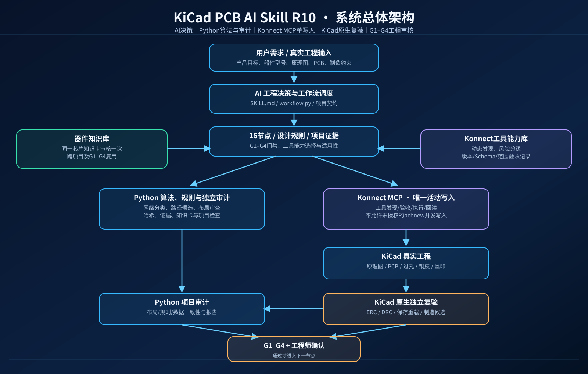

# R10 系统架构与运行流程（候选版）

## 五张可直接查看或另存为SVG的流程图

| 图 | 作用 |
|---|---|
| [器件知识库跨阶段复用](figures/03-device-knowledge.svg) | 节点3→G1/G2/G3/G4 |
| [Konnect动态能力与单写入闭环](figures/04-konnect-capabilities.svg) | 动态发现→按需验收→回读→原生DRC |
| [16节点逐项详细规则](figures/05-16-node-details.svg) | 每节点的工作重点 |

> **仓库当前正式版本仍是 R9.4。** 本目录介绍 2026-11-17 的 R10 独立候选 Skill：器件知识卡跨项目/跨G1–G4复用、Konnect MCP单写入、动态能力发现及风险分级。**这些文档不意味着 R10 源码或安装包已发布到 main**；详见 [迁移与验收状态](05-release-readiness.md)。

## 从哪里开始看

| 阅读顺序 | 图文 | 看完理解什么 |
|---|---|---|
| 1 | [系统总架构](01-system-architecture.md) | AI、Python、Konnect、KiCad、门禁如何协作 |
| 2 | [16节点主线及逐项规则](02-16-node-workflow.md) | 从需求到制造候选的完整执行步骤 |
| 3 | [器件知识库复用](03-device-knowledge-reuse.md) | 芯片资料一次核对、跨项目和G1–G4复用 |
| 4 | [Konnect动态工具与单写入闭环](04-konnect-capability-and-single-writer.md) | 发现工具、按风险验证、执行、读回、DRC |
| 5 | [真实能力及测试状态](05-release-readiness.md) | 已编码与未在真实KiCad端到端验收的边界 |

## 一句话理解

用户提出硬件需求 → AI建立任务计划与项目契约 → 芯片知识库提供已审核依据 → Python负责确定性检查 → Konnect MCP在受控候选中统一执行已具备能力的KiCad写入 → KiCad原生工具独立ERC/DRC → G1–G4和工程师确认 → 形成**待审核**的制造设计资料。

**不是**“AI单击全自动生成可量产PCB”。设计候选、制造候选、CAM/工厂EQ授权、样机测试分开管理。

## 适用角色

- 入门者：从16节点主图认识硬件研发为什么先约束、后设计、再验证。
- 工程师：按G1–G4检查器件依据、引脚/焊盘、布局回流与布线质量。
- Skill开发者：研究缓存优先、操作能力复用、统一写入、独立验证和失败阻断。
