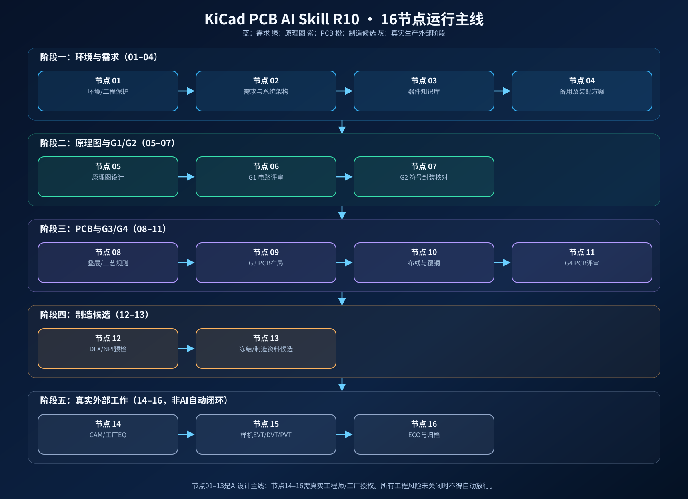

# R10 当前 Skill 架构与运行流程（持续验收版）

> **R10 最新正式验收登记 · 2026-11-18**：维护者确认 Skill 的 GND 首铺铜→检查→批准地孔→二次铺铜→DRC 顺序验证通过，[PR #10](https://github.com/jackwang988/kicad-pcb-ai-workflow/pull/10) 已合并 `main`。这是**维护者验收 PASS**；[软件 CI](https://github.com/jackwang988/kicad-pcb-ai-workflow/actions/runs/44321219956) 通过，但 [独立原生铺铜 CI](https://github.com/jackwang988/kicad-pcb-ai-workflow/actions/runs/44321220007) 仍因保存板网络解析而 BLOCKED（[Issue #11](https://github.com/jackwang988/kicad-pcb-ai-workflow/issues/11)）。历史 R10.0.0 发行包不含本次合并变更。

[本次 GND/DRC 强制顺序](../../kicad-pcb-ai-workflow/references/gnd-before-drc.md) · [R10正式验收矩阵](05-release-readiness.md) · [R10发布补记](../../R10_STABLE_RELEASE_NOTES.md)

## 最新架构与详细流程（优先阅读）

[**R10 最新完整系统架构、16 节点全流程图、Freerouting 7 阶段详细布线流程、测试证据分级**](06-current-skill-full-flow.md)

这份最新版严格区分已编码的软件规划/审核能力、离线 Freerouting SES 候选、真实 KiCad/Konnect 写入与独立 G4 验收。旧版 5 张 SVG 作为历史架构参考保存，不代表最新布线执行顺序。

## 历史五张 SVG 预览

| 图 | 作用 |
|---|---|
| [器件知识库跨阶段复用](figures/03-device-knowledge.svg) | 节点3→G1/G2/G3/G4 |
| [Konnect动态能力与单写入闭环](figures/04-konnect-capabilities.svg) | 动态发现→按需验收→回读→原生DRC |
| [16节点逐项详细规则](figures/05-16-node-details.svg) | 每节点的工作重点 |

> **2026-11-18：PR #6、#7 已合入 main；PR #9 补充原生 GND 保护及实际 NetClass 校验。** 旧版五张 SVG 保留历史参考，其箭头不代表当前七阶段布线顺序。Windows/Konnect 本机验收为维护者报告；[固定版本原生隔离往返测试](https://github.com/jackwang988/kicad-pcb-ai-workflow/actions/runs/44295612537)已通过GND保护（8条普通走线、0 GND）；但同一Fixture的G4 DRC仍有9项违规和2项未连接，跨项目生产验证仍须独立核实，不能由合并操作推断通过。详见 [验收状态](05-release-readiness.md)。

## 从哪里开始看

| 阅读顺序 | 图文 | 看完理解什么 |
|---|---|---|
| 1 | [最新完整架构及布线详细流程](06-current-skill-full-flow.md) | 真实模块关系、最新16节点、七阶段布线、测试层级与能力边界 |
| 2 | [系统总架构](01-system-architecture.md) | AI、Python、Konnect、KiCad、门禁如何协作 |
| 3 | [16节点主线及逐项规则](02-16-node-workflow.md) | 从需求到制造候选的完整执行步骤 |
| 4 | [器件知识库复用](03-device-knowledge-reuse.md) | 芯片资料一次核对、跨项目和G1–G4复用 |
| 5 | [Konnect动态工具与单写入闭环](04-konnect-capability-and-single-writer.md) | 发现工具、按风险验证、执行、读回、DRC |
| 6 | [真实能力及测试状态](05-release-readiness.md) | 已编码与未在真实KiCad端到端验收的边界 |

## 一句话理解

用户提出硬件需求 → AI建立任务计划与项目契约 → 芯片知识库提供已审核依据 → Python负责确定性检查 → Konnect MCP在受控候选中统一执行已具备能力的KiCad写入 → KiCad原生工具独立ERC/DRC → G1–G4和工程师确认 → 形成**待审核**的制造设计资料。

**不是**“AI单击全自动生成可量产PCB”。设计候选、制造候选、CAM/工厂EQ授权、样机测试分开管理。

## 适用角色

- 入门者：从16节点主图认识硬件研发为什么先约束、后设计、再验证。
- 工程师：按G1–G4检查器件依据、引脚/焊盘、布局回流与布线质量。
- Skill开发者：研究缓存优先、操作能力复用、统一写入、独立验证和失败阻断。
