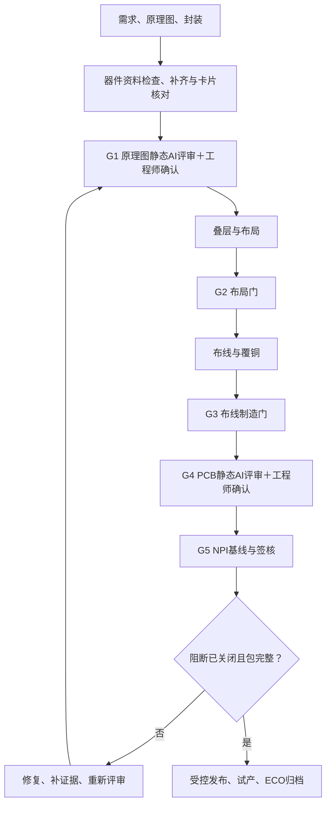

# DFX/NPI 扩展：实现方式、使用与边界

## 目录

1. 版本与流程映射
2. 全部检查项与实现方式
3. 依赖和首次使用
4. 配置与人工签核
5. 生产文件门禁与安全约束
6. 示例和验证边界
7. 官方依据

## 1. 版本与流程映射

适配目标：KiCad 10.0.7。运行包只含有效工具；历史项目脚本单独归档，不作为10.0.7兼容实现。

基线文档实际写的是8阶段，包含独立叠层前置阶段。下表提供10个执行节点以便管理，不将它误称为原有10阶段，也不删除原阶段/门禁。

| 新增管理节点 | 原流程位置 | 叠加门禁 |
|---|---|---|
| 1 需求与AVL | 阶段0 | 输入规则、板厂工艺、变体策略 |
| 2 原理图定稿 | 阶段1 | G1 ERC、层级/BOM、保护/安规评审 |
| 3 封装评审 | 阶段2 | 继续原厂手册封装核对 |
| 4 叠层与规则 | 阶段2.5 | 工艺/阻抗输入，不求解阻抗 |
| 5 布局完成 | 阶段3 | G2 DFR/DFT/机械/PI/SI |
| 6 布线与覆铜 | 阶段4 | G3 DRC/DFM/SMT/拼板 |
| 7 仿真/EMC预检 | 阶段4出口新增独立门 | G4 静态/外部工具/人工证据 |
| 8 候选交付与NPI签核 | 阶段5 | G5 基线/ECO/完整性/签核 |
| 9 试产与测试 | 阶段6 | EVT/DVT/PVT实际验收证据 |
| 10 ECO与发布归档 | 阶段7 | 继续原设计发布确认点 |



所有节点仍沿用原流程的人工确认。`pre_export`只是设计预检，永不产生生产放行授权；`release`才审查候选包完整性。

## 2. 全部检查项与实现方式

“静态预筛”只能提出几何/数据风险；“人工签核”缺证据时阻断。未实现精确几何的项目不冒充已自动化。

| 检查项 | 实现方式 | 当前实现与边界 |
|---|---|---|
| ERC、电气错误分级 | KiCad原生CLI | `sch erc --format json --severity-all --exit-code-violations`；error阻断，warning高风险；原生环境待实测 |
| 跨页标签/网络连通/分层设计块 | 原生ERC + 静态脚本 | 检查子页路径/循环/解析；实际连通性和设计块语义靠ERC/网表及netlist_guard；不宣称文本解析等于电气验证 |
| 变体识别 | 原生导出能力 + 显式配置 | `variants`、`variant_boms`、变体基线；ERC无variant参数；不会猜测未声明变体 |
| 位号、MPN、制造商、封装、规格完整性 | 静态CSV | 可映射字段名；展开逗号/空格分组位号；缺字段和重复位号阻断 |
| 同MPN字段冲突、多变体一致性 | 静态CSV | 比较制造商/封装/规格；仅比较策略声明为不可变的变体字段，允许已批准合法替代 |
| 电源域及五类保护清单 | 静态配置 + 人工 | 读取power_domains及保护角色映射，筛查位号存在；不凭位号证明拓扑有效；人工复核防反接/TVS/保险丝/看门狗/复位 |
| 安规爬电/间隙 | 人工模板 | 填写电压域/工作电压/污染等级/材料组/海拔/绝缘；不自动计算，不给通用安全距离 |
| EOL/NRND | 外部预留接口 | 报告JSON导出MPN待查询列表，状态not_queried；不联网 |
| 电压/功率/电流降额 | 外部预留接口 + 人工 | 提取MPN待核对；没有原厂参数库不作降额合格判断 |
| PCB解析 | pcbnew原生API + 只读文本视图 | `LoadBoard`、`GetFootprints`、`Pads`；不调用SaveBoard。文本fallback仅static-preview |
| netclass | 原生公开API + 静态配置 | 调用公开`GetNetClasses`；不虚构新增过滤方法；网络/功能筛选由脚本显式声明。有效网络类归属和规则合理性仍人工核对 |
| 热源、散热孔、热敏器件 | API几何预筛 + 人工 | 根据声明热源输出坐标/附近过孔候选/热敏距离；散热铜连接、热阻与真实过孔功能须人工，不冒充热仿真 |
| 功率环路面积 | 静态几何近似 | 声明器件中心包围盒面积粗估；不等于真实电流环面积 |
| TP尺寸、间距、遮挡 | API焊盘几何 + 人工 | TP前缀；探针接触尺寸和相邻焊盘包围盒；二维遮挡候选，不证明实体/高度可达 |
| JTAG引出 | 静态网络存在性 + 人工 | 指定网络是否出现在指定连接器焊盘；不证明链路顺序/电气完整性 |
| 器件距板边、固定孔避铜 | API焊盘几何预筛 | 直线轮廓、焊盘包络、孔与焊盘距离；弧线/实体/金属垫圈/全铜形状须DRC/结构复核 |
| 高度干涉 | 人工模板 | 不从二维封装推断三维高度 |
| 去耦/MLCC到电源引脚距离 | API几何预筛 | 显式指定电容、IC、电源焊盘号和原厂阈值；测焊盘直线距离，回路路径另审 |
| 电源分割/参考平面/网络类合理性 | 人工模板 | 已读取stackup和netclass存在性；没有自动PI场/回流路径求解 |
| 差分对 | link_audit端点路径 + 原生API + 人工SI | 区分track/arc/via，端点唯一链路、分层ps延迟及过孔跨度/位置；缺路、分支、重复铜或未知模型阻断；不计算耦合/S参数；旧audit_spec仅历史诊断 |
| 模拟/数字/功率分区、敏感避噪 | 静态声明与几何 | 按声明功能区域检查器件中心；噪声/敏感网络二维距离预筛，不证明实际耦合 |
| 最小线宽/线距/孔径/孔环 | DRC + 静态预筛 | 直线胶囊间距、线宽、过孔名义孔径/孔环；原生DRC负责其它对象；阈值来自板厂配置，超限阻断 |
| 孔纵横比 | 静态近似 | F.Cu-B.Cu通孔按板厚/名义钻孔；盲埋/微孔按实际跨层厚度人工复核 |
| 阻抗规则预检 | stackup静态读取 + 人工 | 查有无叠层、介质厚度/Er；不生成未经计算的阻抗结论，不内置场求解器 |
| 锐角/窄铜/阻焊桥 | 直线夹角、焊盘包络预筛 + DRC/人工 | 锐角交汇/名义阻焊桥候选已实现；真实填铜窄颈与实际阻焊开窗的精确独立检测尚未实现，必须人工/板厂CAM复核 |
| 多层铜面积/板翘 | 静态栅格近似 + 人工 | 简单矩形轮廓下填铜多边形/直线/焊盘外接圆/通孔粗估层占比；非精确CAM面积；不预测板翘量 |
| 覆铜重叠/孤岛 | 原生DRC + 人工 | 检查填充多边形存在性；不同网实际重叠由DRC，孤岛连通性精确独立检测尚未实现 |
| SMT间距/板边BGA | 焊盘包围盒预筛 | 不是器件实体/courtyard完整检测，工艺人员复核 |
| 拼板V-Cut/邮票孔 | 人工模板 | 缺少统一文件语义，不按图形名称自动认定切割线；精确位置/铜距自动算法尚未实现 |
| Fiducial | 命名/封装静态预筛 + 人工 | 检查数量候选；不自动证明拼板级位置/铜避让符合产线要求 |
| SPICE | CLI网表导出 + 外部工具接口 | `spice_precheck.py`先预览，--apply导出SPICE；可显式运行独立ngspice；模型/激励/分析指令须工程师提供 |
| 热仿真 | 外部预留接口 | JSON热源位置清单；无外部软件时只做静态热风险 |
| EMC | 人工静态模板 + 噪声距离预筛 | 检查滤波/接地/屏蔽设计证据；不电磁场求解、不下认证结论 |
| 版本/变体基线 | 静态SHA-256 | 校验原理图、PCB、项目、BOM、子页和变体BOM；版本、批准人、变体集合缺失阻断 |
| ECO | 人工记录模板 | 变更项、原因、影响、风险、验证、批准人 |
| Gerber/钻孔/CPL/装配图/BOM完整性 | 静态清单 + 受控发布 | 显式逐文件清单，不接受通配符；缺文件/空文件/越界阻断；非空不证明文件语义正确，人工审图必需 |
| KiCad jobset | 候选目录静态接口；自动放行暂未支持 | 不执行任意目的地；当前生成命令校验仅支持列出的直接export操作。仅有jobset run日志不能满足D2，须增加经验证的逐项导出记录；未实现目的地语义验证前阻断 |
| EVT/DVT/PVT | 人工签核模板 | 阶段目标、样本、条件、验收、证据、负责人；高低温/湿热/振动/老化按产品适用性选择 |
| CCC/CE前置 | 人工模板 | 人工判定产品与市场适用规范；不是认证或法律合规结论 |

## 3. 依赖和首次使用

### 必选

- KiCad **10.0.7**官方安装包中的`kicad-cli`。
- 能导入对应10.0.7 `pcbnew`的Python 3解释器（解释器版本以安装包为准，不固定为旧包的3.11）。
- Python标准库；新增脚本不强制安装第三方pip库。
- 经批准的板厂/贴片工艺阈值、器件原厂手册、工程基线和人工评审证据属于必需输入。

### 可选

- 独立`ngspice`可执行程序及完整模型/激励测试平台。KiCad集成仿真库不保证等于PATH可调用的ngspice命令，也不固定所有平台构建的库版本。
- 供应链API配置/器件参数库（只检查配置存在性；不自动联网）。
- 外部热仿真、SI/PI/EMC工具、板厂CAM。
- 旧脚本的PyMuPDF等依赖保持原状，不因本扩展而移除。

### 首次执行

新手先按[环境配置与日常启动](environment-onboarding.md)完成真实工具验证；以下是既有脚本入口。

以下假定当前目录为解压后的Skill根目录，`PYK`表示能导入10.0.7 pcbnew的Python。Windows示例路径只是常见安装位置，必须以实际安装为准。

```powershell
$PYK = 'C:\Program Files\KiCad\10.0\bin\python.exe'
$CLI = 'C:\Program Files\KiCad\10.0\bin\kicad-cli.exe'
& $PYK scripts/doctor.py --kicad-cli $CLI
```

Linux/macOS在对应Python环境执行：

```bash
python3 scripts/doctor.py --kicad-cli /actual/path/kicad-cli
```

自检退出0才表示检测到CLI和绑定版本匹配；退出2不能进入量产放行。

1. 复制`assets/review-config.template.json`作为工程评审配置，修改inputs为真实工程相对路径。
2. 填写PCB厂/SMT厂已确认的工艺规则，填写source与approved_by。
3. 按原厂手册填入去耦、电源域、热源、功率环路、差分/噪声/功能分区映射；不能靠AI猜测。
4. 准备各变体评审BOM，锁定已批准SHA-256基线及版本。
5. 执行原流程机检，再执行新增量产预检。报告目录每次必须新建，防止覆盖证据。

```bash
python3 scripts/mass_production_review.py /path/to/project \
  --config /path/to/project/review-config.json --mode mass_production \
  --phase pre_export --output-dir /path/to/new-report
```

6. 根据报告修复自动检测问题，补齐人工签核及外部验证证据；重跑。
7. 设计门禁通过后，用KiCad原生直接export命令在隔离暂存目录生成候选包（jobset自动放行未验收）；受控制造候选使用manufacturing_export；只有明确--apply且原生设计门禁通过才实际导出，后续仍须CAM/EQ及授权。
8. 对候选包运行最终检查并先预览受控发布：

```bash
python3 scripts/mass_production_review.py /path/to/project \
  --config /path/to/project/review-config.json --mode mass_production \
  --phase release --candidate-dir /path/to/candidate --output-dir /path/to/new-release-report
python3 scripts/npi_release.py /path/to/project --config /path/to/project/review-config.json \
  --candidate-dir /path/to/candidate --destination /path/to/new-release
# 仅预览通过且确认发布时：
python3 scripts/npi_release.py /path/to/project --config /path/to/project/review-config.json \
  --candidate-dir /path/to/candidate --destination /path/to/new-release --apply
```

原型模式显式选择`--mode prototype`。新增脚本只返回“沿用原流程”，不冒充已运行旧版所有脚本，也不授予量产放行。

## 4. 配置与人工签核

以示例JSON为schema实例。`baseline.sha256`键为工程内相对路径，值为真实文件SHA-256；配置文件自身哈希进入报告但不自引用锁定。所有实际读取的层级子页也必须纳入批准基线。

```json
{
  "baseline": {"revision": "R1", "approved_by": "工程负责人", "variants": ["default"], "sha256": {"board.kicad_pcb": "真实SHA256"}},
  "manual_reviews": {
    "SCH.CREEPAGE": {"status": "not_applicable", "reviewer": "负责人", "date": "2026-10-17", "reason": "已核实不适用的理由", "evidence": [{"file": "reviews/safety.pdf", "sha256": "该真实文件的64位SHA256"}]}
  }
}
```

`approved`或`not_applicable`必须有reviewer、ISO日期、reason和非空evidence数组（每项为实际文件路径和匹配SHA-256）。人工记录是声明，不验证签字真实性；组织应独立管理证据和批准权限。不允许用人工签核覆盖CLI/DFM检测到的阻断错误。

MPN待查询清单、热源坐标、栅格铜占比和原生命令证据写入报告JSON的`evidence`。不输出密钥、不发网络请求。

ECO模板：

| ECO编号 | 变更项/前后版本 | 原因 | 原理图/PCB/BOM/固件/工装影响 | 风险等级 | 验证项与证据 | 负责人 | 批准/日期 |
|---|---|---|---|---|---|---|---|
| 待填 | 待填 | 待填 | 待填 | 待评估 | 待填 | 待填 | 待批准 |

试产模板：

| 阶段 | 验收项目 | 条件/样本量 | 量化验收阈值 | 结果/证据 | 问题闭环 | 负责人/日期 |
|---|---|---|---|---|---|---|
| EVT | 功能、电源、接口、DFT | 待定 | 来自需求 | 待测 | 待填 | 待签 |
| DVT | 高低温、湿热、振动、老化（适用项） | 产品可靠性计划 | 产品规范 | 待测 | 待填 | 待签 |
| PVT | 产线良率、测试覆盖、追溯、包装工艺 | 试产计划 | 制造质量目标 | 待测 | 待填 | 待签 |

## 5. 门禁与安全约束

- 评审不写任何KiCad源文件。报告输出不视为工程修改，但也不得覆盖原报告目录。
- `--static-preview`永远禁止放行，即使没有发现其它问题。
- 发布实时重跑评审，不信任用户手工编辑的旧报告。校验输入/候选文件哈希，拒绝目标已存在、越界路径与符号链接。
- 生产完整性逻辑采用“设计预检→隔离候选包→最终完整性→受控发布”，解决“尚未生成文件就要求完整性”的循环。存在设计阻断时，Skill流程禁止生成生产Gerber/BOM；候选缺文件则不发布。
- 这是工作流与发布路径约束，不是KiCad原生权限控制。无法禁止用户手工绕过后导出。
- 原厂手册和PCB厂批准规则优先。IPC/IEC等在报告中是参考框架，不是假定全部产品都适用的统一数值或认证结论。

## 6. 工程输入与验证边界

从空模板建立真实项目配置，填写来源批准的工艺阈值、物料、网络、叠层和证据。未填值、缺资料、缺工具和未完成必要确认时保持阻断。开发测试夹具独立分发，不能用作生产工程。使用者必须在目标KiCad环境实际验证；静态报告不能证明动态EMC、热、SI/PI或样机性能。

## 7. 官方依据

- [KiCad 10.0.7 CLI手册](https://docs.kicad.org/10.0/en/cli/cli.html)：版本、ERC/DRC、BOM/网表变体、jobset。
- [KiCad 10项目管理/jobset](https://docs.kicad.org/10.0/en/kicad/kicad.html)。
- [KiCad 10 PCB脚本概览](https://docs.kicad.org/10.0/en/pcbnew/pcbnew.html)：LoadBoard/GetFootprints/GetTracks/GetZones/GetNetClasses；API紧耦合且不保证跨版本稳定。
- [KiCad 10 pcbnew API参考](https://docs.kicad.org/doxygen-python-10.0/namespaces.html)。
- [KiCad PCB Python绑定开发说明](https://dev-docs.kicad.org/en/apis-and-binding/pcbnew/)。

本扩展不承诺将规划中/人工项自动化；精确几何未覆盖项、原生环境集成测试均必须在升级验收报告中显式列出。

## 8. 工程执行顺序与资料契约

先完成原型与产品需求，不得将DEMO参数直接用于产品。当前控制与适用边界见engineering-rules.md；旧项目工具独立归档，不作为最终门禁。

1. 复制工程评审配置与engineering-profile模板，填写产品/版本/负责人、全部源文件、需求追踪、14类评审和21类人工项；未决项保留BLOCKED。
2. 由原生CLI导出前后XML网表，按preserve或有完整批准记录的ECO校验；将各变体网表/BOM与装配适用范围对齐。
3. 运行设计预检；修复阻断，并对每项高风险以具体问题指纹记录工程接受证据。不能接受或豁免阻断。
4. 在独立目录冻结最终覆铜状态，原工程不变；冻结后若再修改，需重新冻结并重跑最终验证。基线必须是经过批准的实际冻结状态，不能仅修改哈希掩盖差异。

```bash
python3 scripts/freeze_candidate.py /path/project --board board.kicad_pcb --destination /path/new-frozen
# 审阅预览后写入新副本：
python3 scripts/freeze_candidate.py /path/project --board board.kicad_pcb --destination /path/new-frozen --apply
python3 scripts/validate_frozen_candidate.py /path/new-frozen --config /path/new-frozen/review-config.json --output-dir /path/new-final-evidence
```

5. 最终设计校验通过后，隔离导出真实Gerber/钻孔/物料/坐标/装配与制板要求，保留实际命令、版本、可执行文件哈希、返回码及日志。支持命令契约：pcb export gerbers/drill/pos/pdf、sch export bom；必须显式--output/-o和正确冻结源输入。每条命令只能声明其实际输出类别/路径，--version/--help不作生成证据。PDF装配层与工艺图内容仍须人工CAM复核。未支持格式或命令直接阻断，不伪造日志。
6. 将最终验证目录完整复制进候选包evidence/final/。用独立CAM查看器打开实际Gerber和钻孔，填写CAM模板；工厂EQ关闭且绑定当前源/全部输出，取得针对工厂/订单范围的生产授权。source_basis_sha256是配置inputs和engineering_profile.source_files的实际文件哈希；output_sha256涵盖全部制造类清单。人工签核并不验证签名真实性，组织需管理权限。
7. 填写assets/export-records.template.json（它是输入模板，不是运行结果），缺文件/空值不能放行。收集D2清单并重跑release；D2清单创建成功本身不表示授权已通过。

```bash
python3 scripts/build_manifest.py /path/new-frozen --config /path/new-frozen/review-config.json --candidate-dir /path/manufacturing-candidate --records /path/export-records.json --level D2
# 审阅预览后，添加--apply生成全新build-manifest.json
python3 scripts/build_manifest.py /path/new-frozen --config /path/new-frozen/review-config.json --candidate-dir /path/manufacturing-candidate --records /path/export-records.json --level D2 --apply
python3 scripts/npi_release.py /path/new-frozen --config /path/new-frozen/review-config.json --candidate-dir /path/manufacturing-candidate --destination /path/new-release
```

8. 所有当前门禁通过后，显式--apply才创建新发布目录；包含已验证资料与依赖证据。任何源、候选或证据变化都重跑。制造交付包必须整体交付，不仅单独发送Gerber；D3产品发布仍需真实样机和可靠性验证。

## 9. R3设计意图前置

差分、电源电流和RF约束在原理图阶段声明，执行方式见[design-intent.md](design-intent.md)。配置必须指定design_intent；独立脚本生成Net Class标签字段、项目精确类分配、原生分层几何Profile和.dru规则。pre_route审计准备状态，final进入量产门禁。RF参考地与天线净空分开，电源不以固定A/mm定宽。原生同步及10.0.7集成仍需实际环境验收。

## 10. R4 静态工程内容评审

G1增加原理图AI内容评审和硬件工程师确认，G4增加全部铜层/关键路径AI评审和硬件工程师确认。执行[static-ai-review.md](static-ai-review.md)，两份当前有效的评审均纳入NPI门禁。根据真实需求、具体MPN原厂手册和适用指南逐项比较；缺依据保持阻断。动态EMC、眼图、温升和可靠性实测留待后期，不计作本轮静态通过。

## 11. R7备用方案与可调试性

执行[reserve-options.md](reserve-options.md)。原理图与PCB增加reserve_options语义评审，量产NPI要求当前已签核策略/板/变体一致，最终检查实际BOM/CPL、互斥和量产保留处置；没有预留且有充分理由不强制加件。完整系统顺序见[full-workflow.md](full-workflow.md)。

## 12. R8专业与视觉布局

布局执行[placement-quality.md](placement-quality.md)：模块/角色完整归属，指定端子的去耦，支持courtyard/通道/固定点，美观仅建议，pre_route与final证据复验；NPI绑定已确认PCB布局策略。原有距离和包围盒检查仅预筛，不作为去耦/真实回路合格证明。未知几何、实际回流、3D/丝印与布线容量仍需原生/AI/工程师验证。

## 通用契约与导出

配置workflow_contract、schematic_style与system_integration；新项目使用当前静态模板。原理图评审必须绑定系统架构首页、模块归属、跨模块网络端点和每条接口的来源/验收任务；缺失或与已确认packet不一致即NPI阻断。预导出只验证到NPI的契约输入，后置CAM不形成导出循环。冻结及当前原生设计门禁通过后用manufacturing_export向独立新候选导出，不执行任意jobset；完成后仍需实际CAM/EQ/工程师授权及npi_release。旧R8配置兼容诊断，不等于R9/R9.1新增控制已经应用。
