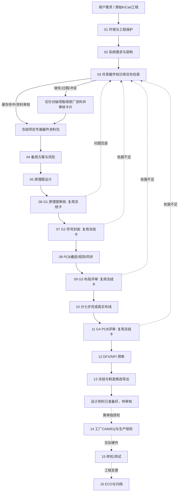

# KiCad PCB AI Skill · 最新完整系统运行流程与逐节点工程规则

**版本**：R10.0-alpha.3-local.5 + cache-first + G1-G4 + Konnect单写入迁移-1  
**日期**：2026-11-16  
**适用对象**：新建或已有 KiCad 工程；本文件描述实际已有脚本、必须由 Agent/工程师完成的操作及尚未实现的规划。  
**主要设计终点**：`DESIGN_PACKAGE_READY_FOR_REVIEW`（设计资料齐全、待审核的摘要状态，不是脚本自动发放的工厂生产许可）。

> 阅读顺序：`SKILL.md` → 本文件 → 对应模块文档 → 特定脚本的 `--help`。本版与历史 `full-workflow.md` 的阶段边界不同时，以 `design-execution-local.md` 和本文件的**当前设计主线**为准。历史16节点保留作兼容导航；14–16节点仅作为外部扩展，不由AI设计主线自动执行。

> **2026-11-17最新迁移优先规则**：本文件的16节点与知识复用仍保留，但下文历史"pcbnew离线写入/必须配对"描述已被[Konnect单写入与动态能力规范](konnect-capability-migration.md)覆盖。节点01默认CLI-only启动；节点05/08/09/10通过实际发现的Konnect工具实现活动KiCad修改；节点10的离线A*和Freerouting候选仅做计算/计划，不允许自行写PCB；节点13覆铜改为Konnect候选交接→真实操作收据→独立KiCad CLI重载/DRC。少数旧只读pcbnew原生几何/NetClass审计仍可用但不是写入后端，未完成等价适配就不能声称制造放行。节点03知识库以及G1—G4跨阶段复用不变。

## 0. 一图看懂



## 1. 四类执行主体：彻底避免两套系统同时写PCB

| 职责 | 默认执行方 | 允许做什么 | 不允许做什么 |
|---|---|---|---|
| **工程决策** | AI Agent；关键点交硬件工程师确认 | 读项目、读已核对知识卡、规划约束/优先级、给出操作序列与问题定位 | 不得伪造原厂参数、量测结果、人工签字或自动宣布合格 |
| **确定性计算与独立审计** | Python 脚本（部分调用 pcbnew 只读API） | 读网表/PCB、几何/网络核对、标准化检查、输出报告、按哈希识别改动 | 不得把A*候选当成PCB真实铜线；不能把数据一致性当电气真实性 |
| **实时PCB写入** | 经本机验收的 Konnect MCP / KiCad IPC工具 | 按已批准的请求在当前选定KiCad工程中移动、旋转、布线、丝印、过孔等 *后端已验收的操作* | 不得在无能力验收时使用该功能；不得与另一个写入者同时修改同一工程 |
| **原生验收** | KiCad CLI及相应版本原生API，随后AI+工程师 | 独立重载并执行ERC/DRC、网络/层/规则检查、检查真实保存结果 | 不得把ERC/DRC零错误等同于SI、PI、EMC、可靠性、样机和量产通过 |

**读写状态机**：检测当前板身份及哈希 → 选定唯一写入者 → 生成候选/执行小批操作 → 回读对象UUID、坐标、焊盘与网络 → 保存 → 交接写入权 → 从磁盘重载候选 → Python和KiCad独立验证 → 把证据绑定同一版本。修改未保存时，禁止独立pcbnew覆盖同一`.kicad_pcb`。既有 `freeze_candidate.py` 的离线覆铜/保存只能在已保存并交接的独立候选文件上运行。命令执行超时先回读状态，不盲重试。不支持的后端功能直接 `BLOCKED`，不能偷偷切换另一套未验收的写入接口。

## 2. 器件资料只建立一次、跨项目/阶段复用的统一规则

1. **知识库保存位置**：共享持久目录 `device-cache/` 放在 Skill、工程候选和公开ZIP之外，含 `objects/`原文、`texts/`提取文本、`records/`文档版本、`cards/`已核对条目、`evidence/`核对证据、`registry/`跨项目索引。项目另有冻结副本，保证未来共享库被修改也不影响已审工程的原始证据。
2. **唯一匹配键**：`manufacturer + exact MPN + package`；位号 `ref` 和实际 `application` 在每个项目里独立声明。晶圆版本/温度等级/装配变体若影响适用性，额外进入项目条件；不按系列模糊匹配。
3. **查询优先级**：新项目/器件替换/节点3先执行离线 `resolve`，命中后 `audit → bundle` 冻结；仅 `MISS/STALE` 允许返回节点3对缺项核实原厂最新版本，必要时获取本地资料。`AMBIGUOUS/INVALID_CACHE_ENTRY` 必须人工解决冲突，不能自动挑选。
4. **初次入库**：原厂资料真实阅读（含PDF图表）、按来源页/图/章节制作每条知识卡、注明值及温度/电压/模式/修订、核对真实证据，然后 `register`；`verified`只表示资料已由指定过程核验，不能证明它适合每个新项目。
5. **跨阶段G1—G4**：所有评审使用节点3生成的**同一项目冻结资料包**；阶段仅提取相关条目，保存来源哈希及locator。节点6 G1检查实际原理图，节点7 G2检查真实符号封装，节点9 G3检查真实PCB布局，节点11 G4检查真实布线及参考地；即使同一知识卡复用，**每一工程的设计审核必须重新做**。
6. **摘要省Token**：优先载入短卡、必要项目几何/网络，遇到截断`truncated=true`或复杂图表/冲突/风险点时，只打开本地冻结PDF对应章节；同源SHA命中时复用已提取的`texts/`，避免重复`pdftotext`。不能保证固定Token节省比例。
7. **可靠性底线**：任一资料文件哈希变更、核对证据过期、版本冲突、卡片缺少本阶段关键类别，停止该节点；返回节点3做**针对性的补充核对**，不是全量重新下载。原厂发布更新、工程关键条件变更或正式签核前必须按实际政策重新核对；本地缓存不提供厂商实时更新通知。
8. **共享与授权**：公开Skill ZIP不包含厂商原版PDF、商业保密文档、个人缓存、客户项目与真实审核证据。非公开团队共享知识库需要单独版权/权限评估。

### 阶段卡片类别与当前代码

| 关口 | 主要复用条目举例 | 自动生成/验证 | 设计验收仍需完成 |
|---|---|---|---|
| **G1 节点6** | 推荐外围、电源、启动、引脚、接口 | `static_review.py --stage schematic` → `device-knowledge-brief.json`；`static_review_gate.py`复核 | 当前网表、ERC、原理图图面和工程师签核 |
| **G2 节点7** | `pinout`、`footprint_pinmap_variants`、`land_pattern`、`thermal_pad`、`package`等 | `resource_guard.py check --review-config` → `g2_device_knowledge`；逐芯片精确身份与资源锁匹配 | 符号Pin↔物理Pad、电气类型、EP、极性、Land Pattern及当前装配版本 |
| **G3 节点9** | `decoupling`、`clock`、`rf_antenna`、`placement`、`power_return_loops`等 | `placement_review.py --review-config` → `g3_device_knowledge`；检查核心位号存在于当前板 | 器件真实位置、回流、模块通道、净空、可布线性、当前布局G3 |
| **G4 节点11** | `critical_signal_paths`、`stackup_reference_planes`、`pads_vias_fanout`、`rf_antenna`等 | `static_review.py --stage pcb` → `device-knowledge-brief.json`；G4 gate重算摘要 | 真实全铜层、回路、DRC、差分/高速、电源地和当前PCB最终静态审查 |

当前脚本不自动判断知识卡里所有语义是否适合新工程，也不会自动补写已有知识卡缺少的类别。有关阶段若无相关已核对条目将报告 `STAGE_CARD_COVERAGE_INCOMPLETE`，执行入口阻断；**必须回节点3核对原始资料、补卡并重新冻结**，不是直接给PASS。

## 3. 完整16节点逐项流程

### 01 环境与工程保护（`environment`）
- **输入**：项目目录、`.kicad_sch/.kicad_pcb/.kicad_pro`、目标KiCad版本、已获许可的MCP后端。
- **处理**：用`doctor.py`/`environment_start.py`按需核对版本、CLI、pcbnew；用`konnect_backend.py`、`kicad_ipc_probe.py`只读核对连接、板路径、后端版本与能力；生成独立候选，记录原工程哈希，确定唯一写入者。
- **规则**：环境不支持就`BLOCKED`；连接探测不创建/修改测试板；未来版本不能仅因版本号较大就假定API兼容。
- **输出/关口**：版本与能力报告、板身份、工程保护策略；**不会自动批准工程**。

### 02 需求与系统架构（`requirements`）
- **输入**：产品功能、供电、功耗/峰值、电气接口、尺寸、安装、可靠性与成本边界。
- **处理**：AI拆分模块、电源树、信号流、接口矩阵；`project_flow.py`把每条需求绑定来源、验收条件和验证节点；`system_integration.py`校核跨模块接口契约。
- **规则**：不能给未定义电流/温升/阻抗写默认值；功能不适用要给依据；需求→验收必须可追踪。
- **输出/关口**：需求矩阵、系统架构图、电源/接口契约、待确认项。

### 03 原厂资料与器件知识库（`sources`；Cache-First）
- **输入**：核心芯片准确制造商、MPN、封装、用途/位号、资料种类、更新时效策略。
- **处理**：`device_knowledge.py resolve`首先离线查共享库；精确命中调用`brief`、`audit`、`bundle`冻结所需卡片与原版证据；缺失才按厂商官方页面获取、实际核对手册/勘误/布局图，制作卡片并`register`。
- **规则**：来源文件/文字/卡片/审查记录SHA-256一致；缺失/过期/冲突不猜测；不混用相似MPN和封装；知识卡不是具体设计PASS。
- **输出/关口**：项目冻结`device-bundle.json`、卡片引用及证据；不重新下载已有效资料。

### 04 备用方案与工程风险决策（`reserve`）
- **输入**：需求、原厂建议、物料替代、装配变体、可测试/返修要求。
- **处理**：`reserve_review.py`记录0Ω/跳线/DNP/备用元件是否必要、默认贴装、互斥组合与风险。
- **规则**：不能无理由堆放备用件；备用电路可能造成残桩、供电冲突或DFM风险，必须核对。
- **输出/关口**：预留决策记录、变体矩阵和需要在原理图/PCB落实的约束。

### 05 原理图绘制（`schematic`）
- **输入**：系统电路拓扑、已冻结器件资料、符号库及每个模块的真实引脚与网络。
- **处理**：先网络拓扑与跨页通道、再器件和Port/标签的相对布局；通过已验收原理图后端或受限`schematic_candidate.py`创建候选；导出真实XML网表，逐引脚对照预期。
- **规则**：不可凭图形相交推断电气连接；复位/BOOT、电源使能、去耦、接口保护和未用脚要按原厂工况；跨页、镜像与层次信号需检查；尚无通用自动原理图几何引擎，不伪称全自动。
- **输出/关口**：可打开的原理图候选、实际XML、图面评审材料与ERC前置数据。

### 06 原理图评审 G1（`schematic_review`）
- **输入**：当前原理图、网表、ERC、项目冻结器件包、产品要求与参考电路。
- **处理**：`static_review.py --stage schematic`首先提供冻结知识卡摘要，复用原厂已提取文字；AI按电源、时钟、复位、接口、引脚、推荐电路核对**本项目实际连接**；`static_review_gate.py`复验输入并等待真实硬件工程师确认。
- **规则**：不重新搜/下载相同规格书；涉及图形/脚注/特殊模式时阅读本地冻结原文；ERC通过不等于功能正确；证据缺失/FAIL不改写PASS。
- **输出/关口**：G1 packet、`ai-review.json`、工程师记录；未关闭阻断级问题不进入下一节点。

### 07 符号、封装与焊盘映射 G2（`footprints`）
- **输入**：G1确认后的芯片清单、冻结资料包、符号、封装、Pin/Pad映射、资源锁。
- **处理**：`resource_guard.py lock`创建当前实际库文件哈希锁；`resource_guard.py check --review-config ...`离线复用G2相关卡片并核对芯片**制造商+MPN+封装**与资源锁一致；检查每个符号pin的电气类型、pin编号、footprint焊盘编号和EP/极性。
- **规则**：资源文件一致不等于原厂正确；必须查真实pinout、推荐land pattern、EP、极性、Pin 1标记，工程师最终确认；缺失G2卡片条目返回节点3补充，不能无依据自动通过。
- **输出/关口**：资源锁、G2缓存依据摘要、当前资源一致性报告、G2人工签核；不自动安装未知供应商库。

### 08 PCB叠层与可制造规则实际生效（`stackup`）
- **输入**：同步后的真实PCB、工厂叠层、铜厚/介质、最小线宽间距、孔与孔环、阻抗/差分及高电流需求。
- **处理**：`design_intent.py`编译网络类及原生约束候选，`design_intent_audit.py`回读真实项目参数/网络覆盖；保存重载，按适用能力检查规则命中，必要时用独立违规注入测试副本证明规则确实有效。
- **规则**：先规则后布局/布线；参数必须有工厂/原厂依据；没有实现的规则标`unsupported`并阻断相应操作；不能由JSON已写入推断KiCad已生效。通用原生违规注入自动化仍属后续验证，不得声称全部实现。
- **输出/关口**：实际层序、`.kicad_pro/.kicad_dru`候选、工程规则回读证据与未覆盖项。

### 09 PCB布局与布局评审 G3（`placement`）
- **输入**：G2资源、工厂规则、当前PCB、原理图网表、模块区域和布局约束。
- **处理**：AI优先固定连接器/孔/接口、关键电源和晶振/保护/天线等局部；Konnect MCP在已验收范围内实施移动/旋转；`placement_review.py --review-config ...`离线复用冻结G3知识卡，核对核心器件确实在板上，计算真实焊盘距离/模块区域、生成可追溯布局图和报告。
- **规则**：硬机械/电气约束优先于整齐；不拿器件中心距离当电流返回路径；当前`placement_review.py`是**只读布局检查器，不是自动布局优化器**。缺卡、封装/板身份变化或G3问题未关闭则阻断。
- **输出/关口**：真实布局候选、G3卡片摘要、位置/局部电路审计与工程师G3审核。

### 10 PCB布线与覆铜（`routing`，细化七步）
- **10.1 规则核验**：确认制造叠层/净空/孔规格、NetClass、差分、保护对象、G3、已验收路由后端，缺规则即阻断。
- **10.2 全网分类**：电源/高电流、时钟/复位、差分/高速、RF/模拟敏感、普通信号、GND及Kelvin/安全网络逐个分类并核对覆盖；不把未知网默认为普通。
- **10.3 优先关键网络**：按原厂路径、参考层、回流与时序，先处理敏感/高速/难逃线路，保护已经验收的走线。
- **10.4 普通信号分批走线**：AI制定计划，Python可生成搜索候选，Konnect执行实际受支持的铜线写入；小批回读网络、过孔、长度、连接数。`script_route_search.py`仅离线网格A*，不能当做真实KiCad布线证明。
- **10.5 电源与地**：计算实际载流/压降/温升约束、覆铜与连接、地回流及缝合；**不能默认全部GND不布线只靠最终铺铜**。铺铜完成检查孤岛、热焊盘/颈缩和参考面连续性。
- **10.6 优化**：对线宽/间距、换层、差分耦合、过孔/阻抗模型、关键路径、回流及保护对象进行实测几何复核；不为了路径最短牺牲硬规则。
- **10.7 保存与复验**：保存真实候选、交接写入权、必要时在隔离副本执行pcbnew覆铜/冻结、重新加载、原生DRC、连通性、未连网、规则命中及前后对象差异检查；不允许只看SES或AI一句“布完”。
- **输出/关口**：当前PCB铜层和规则证据；必要网络连通、无未经处理的阻断项后进入G4。

### 11 PCB最终审查 G4（`pcb_review`）
- **输入**：当前完整PCB、全部铜层/叠层/规则、最终网表、冻结器件包及前述检查报告。
- **处理**：`static_review.py --stage pcb`自动生成G4精简知识卡摘要和来源文件快照，复用相同SHA的提取文字；AI逐层审去耦、晶振、RF、差分、高速、电源和回流、过孔/间距与机械布局。`static_review_gate.py`重新计算知识卡与当前工程基线；确认实际D​​RC（不是纯文本解析）并由工程师审核。
- **规则**：卡片只是本项目的依据候选，不可自动宣告PCB已合格。DRC不能证明阻抗、SI、EMC和可靠性；未读真实铜层/缺实际几何时保持`NEEDS_EVIDENCE`。知识条目缺失、资料改动、PCB变更后旧G4无效。
- **输出/关口**：G4 packet、各层观察记录、AI逐项结论、工程师审核记录；通过静态G4不代表产品测试或生产授权。

### 12 DFX/NPI预检查（`npi`）
- **输入**：当前G1–G4证据、制造工艺、BOM/变体、已保存PCB与装配需求。
- **处理**：`mass_production_review.py`检查可制造性、装配性、测试性、物料一致性、PCB机械/钻孔和必要设计风险；高频/电源专项按真实适用条件追加。
- **规则**：任何缺少、过期、与本次文件版本不一致的门禁不能转为生产就绪；没有测试能力则记录待实测，不把静态分析当实测。
- **输出/关口**：NPI风险矩阵、阻断项、DFM/DFT待工厂确认项。

### 13 冻结和制造候选导出（`manufacturing`）
- **输入**：可审核工程、工厂规则、变体BOM、G1–G4、NPI报告和真实工程SHA。
- **处理**：`freeze_candidate.py`/`validate_frozen_candidate.py`冻结隔离候选；`manufacturing_export.py`导出Gerber、钻孔、BOM、装配相关文件；`build_manifest.py`生成输出清单与哈希。真正导出前再检查实际相关门禁。
- **规则**：默认新目录、禁止静默覆盖原工程；导出成功只表示`EXPORTED_NOT_RELEASED`，不能自动填写CAM/EQ、工厂签核或量产放行。
- **输出/关口**：制造候选包、检查记录、哈希清单；只有适用检查和交付核对完成，才可在报告摘要注明`DESIGN_PACKAGE_READY_FOR_REVIEW`（不是脚本原生状态）。

### 14 CAM/工厂EQ与正式生产授权（`cam_release`；**外部扩展**）
- **输入**：节点13候选文件、工厂CAM评审和书面问题/授权。
- **处理**：由实际工厂及授权工程师核对叠层、钻孔/阻焊/钢网、阻抗、拼板、装配和EQ，按实际结果处理。
- **规则**：AI可以整理资料和问题清单，但不得自称完成工厂审批、生成不存在的签核。
- **输出**：外部真实CAM/EQ证据与工厂生产授权；不在AI主设计流程自动触发。

### 15 样机和EVT/DVT/PVT测试（`prototype`；**外部扩展**）
- **输入**：已制造样机、测试工装、测试规范和真实量测。
- **处理**：硬件工程师实际进行上电、接口、噪声、温升、EMC/协议、可靠性等适用测试；AI仅协助计划、报告分析和故障定位。
- **规则**：不得虚构硬件、测试结果或通过证据；没有设备/人员就标外部未执行。
- **输出**：实测记录、问题与整改建议。

### 16 ECO工程变更和归档（`eco`；**外部扩展**）
- **输入**：旧版本工程/问题、修改原因、最新实验和生产反馈。
- **处理**：明确变更范围、影响的知识卡/设计条件、网络/封装/PCB/制造文件；新候选重做相应ERC/DRC、G1–G4及工厂文档，留存历史。
- **规则**：旧文件哈希与签核不得在新版本直接复用；不覆盖原始交付；实际工程师决定变更放行。
- **输出**：新版本变更记录、受影响门禁的再验证证据与归档资料。

## 4. 失败/阻断恢复规则

| 事件 | 正确处理 | 禁止做法 |
|---|---|---|
| `MISS` | 回节点3精准补齐缺少的文档种类并登记 | 对该器件重新抓取全网全部文档 |
| `STALE`或厂商勘误 | 重新核对该文档版本、保留记录、评估受影响设计 | 静默更新日期使旧卡继续有效 |
| `AMBIGUOUS/INVALID_CACHE_ENTRY` | 阻断；排查版本/哈希/身份冲突 | 自动选最新字符串或相似MPN |
| `STAGE_CARD_COVERAGE_INCOMPLETE` | 仅补本节点所需的原厂章节和核对卡 | 没有pinout/布局规则却照常给G2/G3/G4 PASS |
| PCB GUI与文件不同步 | 交接写入权、保存、重载，再审 | 在Python脚本直接保存旧板覆盖GUI改动 |
| MCP不支持当前动作 | 阻断并记录后端能力缺口 | 自动切换未经验证写入后端 |
| ERC/DRC FAIL | 修复实际工程、重跑原生检查 | 降低规则、删除器件或忽略高风险问题 |
| 工程/约束哈希变化 | 新建候选与审查包，重做受影响检查 | 只把原审核报告中的哈希替换成新值 |
| 资料准备成功但无工程师确认 | 报告`PENDING`，保留未批准 | 把软件检测PASS当人工签名 |

## 5. 关键命令（路径、项目文件名需替换为真实值）

```bash
# 初始化/查看流程：默认预览；通过确认后才使用--apply写全新配置
python scripts/workflow.py init /project
python scripts/workflow.py build /project --bundle control-r1
python scripts/workflow.py status /project --bundle control-r1

# 节点3：首次或新项目先查长期共享知识库，不联网
python scripts/workflow.py run /project --task architecture.sources_resolve --device-cache /shared/device-cache --device-inventory device-inventory.json
# 完全命中以后，再通过audit/bundle创建项目冻结包
python scripts/device_knowledge.py --cache /shared/device-cache bundle --requirements /project/resolved-device-requirements.json --output /project/device-sources-r1 --apply

# 节点7 G2：现有资源锁 + 项目静态review配置（内含device_knowledge）
python scripts/resource_guard.py check /project --lock resource-lock.json --review-config /project/static-review.json
# 统一workflow入口会自动传入当前静态配置快照：
python scripts/workflow.py run /project --bundle control-r1 --task schematic.resources_check --resource-lock resource-lock.json

# 节点9 G3：布局只读审查，输出目录必须是新目录
python scripts/placement_review.py /project --policy placement-plan.json --netlist actual-netlist.xml --board actual-board.kicad_pcb --phase pre_route --review-config /project/static-review.json --output-dir /project/reviews/layout-r1
# 无pcbnew时只可以用--static-preview演示，不能当原生几何验收

# 节点6 G1 / 节点11 G4：均从项目冻结资料包提取精简卡
python scripts/static_review.py /project --config /project/static-review.json --stage schematic --output-dir /project/reviews/G1-r1
python scripts/static_review.py /project --config /project/static-review.json --stage pcb --output-dir /project/reviews/G4-r1
# 生成packet后必须完成AI逐项审查 + 真正工程师审核，再执行static_review_gate
```

## 6. 实际实现程度与兼容性声明

- 本次在 `device_knowledge.py`、`resource_guard.py`、`placement_review.py`、`static_review.py`、`static_review_gate.py`、`workflow.py` 增加/接入G2/G3/G4缓存复用；已有G1逻辑不变，旧项目如果没有绑定可继续按既有脚本运行，但不能声称已享有器件库复用门禁。
- **本次测试范围**：离线合成资料、Python脚本与模拟PCB数据；真实 KiCad GUI/MCP、原厂PDF真伪、工程高频性能、实际CAM和样机测试均未由本次代码测试验证。
- 这不是新布局优化引擎、布线AI、SI/PI求解器或自动制造授权。`placement_review.py`仍是只读检查器；`script_route_search.py`仍是离线网格候选搜索；部分原生工艺违规注入与动态性能验证仍需未来实现。
- KiCad补丁/大版本要按`doctor.py`、真实CLI/IPC能力和本机已验收记录分别核对，不可无条件认定新版本向后兼容。
- 文档和缓存能降低重复劳动与模型上下文开销，但没有实际测量Token节约百分比，不许给出虚构收益。
