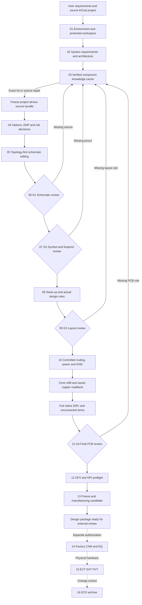

# R10 Complete Engineering Workflow: 16 Nodes, G1–G4 and Evidence Boundaries

**Applicability:** New or existing KiCad projects; status as of R10's Konnect single-writer migration. The principal AI design flow ends at `DESIGN_PACKAGE_READY_FOR_REVIEW` as a *summary label* (not a script-generated factory release). Nodes 14–16 are external, separately authorized lifecycle activities. This document overrides conflicting historical descriptions in `full-workflow.md`; the current single-writer rule in `konnect-capability-migration.md` overrides legacy `pcbnew` editing instructions.

## Architecture and authority



| Role | Required actions | Prohibited shortcuts |
|---|---|---|
| **AI and engineer** | Engineer-backed requirements, constraint reasoning, execution plan, risk disposition | Fabricated datasheet data, measurements, signatures or acceptance |
| **Python** | Read-only extraction, device-cache verification, geometry and network algorithms, immutable evidence | Treating simulated routes as actual copper or silently editing the live board |
| **Konnect MCP** | All authorized *active EDA edits*, selected through dynamic discovery, risk classes and scope-bound acceptance | Concurrent writing, unverified fallbacks and unlimited retries |
| **KiCad native CLI** | Independently reload the saved project, run ERC/DRC, validate native netlist and manufacturing files | Pretending zero DRC errors proves SI/PI, thermal/EMC or factory approval |

When operating the active working project, verify its path, revision and UUID/net targets, hold one writer, apply small batches, read back, save, hand off the writer, and independently verify the saved state. On a timeout or mismatch, inspect state before considering a retry. An offline design generator may only write a distinct, not concurrently open candidate. Legacy `pcbnew` remains optional for constrained read-only compatibility; the old default `pcbnew` zone-fill writer is disabled.

## Device knowledge is shared; engineering acceptance is not

Use one durable external `device-cache/` containing original objects, extracted text, source revisions, cards, evidence and an exact-match registry. Match by **manufacturer + exact MPN + package**, with project-specific reference/application/operating conditions. First run `resolve`. Use verified hits, `audit` then project-specific `bundle`; repair only missing/stale document kinds. `AMBIGUOUS` and `INVALID_CACHE_ENTRY` block. Do not silently choose an adjacent part number or bump a stale date.

A verified card needs a document SHA, revision, original locator/page, engineering conditions and real review evidence. Reuse `brief` so AI sees only relevant lines. Figures, footnotes, ambiguous parameters, special modes and missing coverage still require reading the frozen original source. Never include vendor PDFs, private customer designs or unreleasable licensed documentation in a public Skill archive.

| Gate | Reused card types | Mandatory per-project checks |
|---|---|---|
| G1 / 06 | Recommended circuit, power, startup, reset, clock, interface | Actual pin/net connectivity, ERC, visual schematic and engineer review |
| G2 / 07 | Pinout, pad mapping, land pattern, EP, polarity and package | Real symbol-to-footprint numbering, resource lock and assembly variant |
| G3 / 09 | Decoupling, oscillator, RF, thermal, placement and return-loop guidance | Real board geometry, critical parts, mechanical clearance and routing channels |
| G4 / 11 | Fast paths, layers, reference planes, via/fanout, RF and return guidance | All actual copper, netlist parity, native DRC, AI and engineer sign-off |

`STAGE_CARD_COVERAGE_INCOMPLETE` means return to node 03 for a source-backed specific addition. It is not a reason to skip a gate or download the whole manual again. Source or project changes invalidate dependent evidence independently.

## Node-by-node execution

### 01 — Environment and project protection (`environment`)

**Inputs:** Actual `.kicad_pro`, `.kicad_sch` and optional `.kicad_pcb`; installed KiCad CLI, licensed Konnect backend and current project index. **Method:** Run lightweight target connection once; use doctor/setup for new installations and requested deep validation. Validate executable identity, current KiCad version, selected board path and allowed MCP scope; register one authoritative workspace. **Gate:** Unsupported or wrong board is `BLOCKED`; a connection query does not create a board, edit user files or approve production.

### 02 — Product requirements and system architecture (`requirements`)

**Inputs:** Functional requirements, supply/current and transient loads, interface voltages, clocks, dimensions, temperatures, reliability and cost constraints. **Method:** Map functions to blocks, power tree, interface matrix, signal flow and measurable requirement-to-source-to-test rows using `project_flow.py` and `system_integration.py`. **Gate:** Missing values and unknown requirements remain unresolved, never invented. **Output:** Architecture, explicit constraints, acceptance matrix and tracked open questions.

### 03 — Official manufacturer evidence and reusable device cache (`sources`)

**Inputs:** Manufacturer, exact MPN, package, reference, application, required document kinds and freshness policy. **Method:** Offline `device_knowledge.py resolve`, select verified source cards, source audit and freeze a project bundle. For missing/stale kinds only, obtain and actually inspect manufacturer datasheets, errata, reference layouts or application notes; register revised cards with original evidence hashes. **Gate:** Mismatches, stale checks, inconsistent source SHA or unsupported application conditions block. **Output:** Source bundle and short, verifiable per-device cards.

### 04 — Alternatives, DNP and risk management (`reserve`)

**Inputs:** Architecture, component sourcing, default assembly states, diagnostics/test access, proposed 0-ohm/selector/jumper/fallback circuits. **Method:** `reserve_review.py` records the rationale for both included and omitted options, assembly variants, exclusive-fit groups and real risks. **Gate:** Do not insert unexplained placeholders; test both fitted and DNP states for residual stubs, power shorts, sensitive coupling and fabrication/assembly constraints.

### 05 — Topology-first schematic creation (`schematic`)

**Inputs:** Exact source-backed symbols, power tree, current net topology, off-page ports and design intent. **Method:** Solve module/network and wiring corridors before final symbol placement; use a verified Konnect schematic operation in an authorized working project or `schematic_candidate.py` for first-time isolated candidate generation. Generate a *native* KiCad XML netlist. **Gate:** Verify real symbol pins, hierarchical/net labels, NC handling, reset/BOOT, enable, decoupling and interfaces; graphical touching does not prove connection. Do not assert a universal automatic schematic drawing engine exists.

### 06 — G1 independent schematic review (`schematic_review`)

**Inputs:** Saved schematic, native netlist/ERC, frozen manufacturer bundle, requirements and layout/visual evidence. **Method:** `static_review.py --stage schematic` creates a short `device-knowledge-brief.json`, current network facts, actual manufacturer source locators and graph tasks. AI compares power, sequence, clock, reset, startup and external interfaces against the actual circuit. **Gate:** Native ERC, review report, current revision binding and a real engineer signature are separate. Unresolved blocking risks or unsupported views stop G1; no second full datasheet download.

### 07 — G2 symbol/footprint/pin mapping (`footprints`)

**Inputs:** Confirmed schematic, frozen exact-part cards, KiCad symbol and footprint library files, pin/pad map and `resource_lock`. **Method:** Hash-lock trusted resources and call `resource_guard.py check --review-config` to reuse pinout/land-pattern knowledge. Check every physical pad/symbol pin number, electrical type, pin-1 marker, exposed pad, polarity, NC pin and assembly variant. **Gate:** An unchanged library is not necessarily a correct manufacturer library. Missing coverage returns to node 03; current package mismatch blocks G2.

### 08 — Stack-up and effective manufacturing rules (`stackup`)

**Inputs:** Real PCB synchronized with schematic, approved board-house layer stack, copper/dielectric, via/drill capability, annular ring, edge clearance, impedance/differential and current limits. **Method:** Compile `design_intent.py` rule candidates, save via accepted EDA writer and use `design_intent_audit.py` to read actual active layers, NetClasses/custom rules and net coverage. If available, exercise violated-rule fixtures in an isolated test board to prove the intended DRC rule triggers. **Gate:** JSON entry existence alone is not proof of native rule activation; unsupported constraints are explicitly blocked.

Before G3, offer the JLCPCB 2/4/6/8-layer conservative fabrication profile, **show all values and obtain explicit user confirmation**. Store profile/board/source-bound immutable approval; Konnect then sets the actual KiCad stackup, Board Setup and NetClasses, which must be independently read back. Changed profile/layers/thickness means re-confirm, not bypass. See [JLCPCB user confirmation](jlcpcb-fab-confirmation.md).

### 09 — G3 placement and physical layout review (`placement`)

**Inputs:** Current PCB, G2 resource map, board outline and constraints, XML netlist, critical device placement cards. **Method:** Anchor connectors, holes and mechanical restrictions; place power loops, oscillators, RF, sensitive analog and high-speed escape paths before aesthetic cleanup. Konnect applies accepted moves where capability permits, **saves and reads back actual footprint positions**. `pcb.placement_pre` / `placement_review.py --phase pre_route --review-config` checks current real components/pads, Courtyards, mechanical keepouts, critical pin-level placement rules and prospective routing corridors. **G3 is a layout-only gate: do not invoke full-board KiCad DRC and never require zero unconnected nets before routing.** Airwires are expected. Assess routing feasibility, return-path topology, manufacturability and mechanical access; pad-center distance does not prove a completed current return path. This Python checker does not itself execute automatic placement or native DRC.

### 10 — Seven-step routing and zone-fill (`routing`)

1. **Manufacturing/rule preflight:** Confirm active stack-up, trace/clearance, drills, net class, G3 status, protected objects and accepted backend.
2. **Classify every net:** Power/high current, clock/reset, diff/high-speed, RF/sensitive analog, ordinary signals, GND, Kelvin and safety classes. Unknown nets do not silently default to ordinary.
3. **Route hard nets first:** Escape and plan timing-/noise-/return-critical interconnect, preserving pre-approved geometries.
4. **Route ordinary nets in small batches:** Python may produce A* suggestions; Konnect executes only tools covered by actual capability acceptance, then reads nets/vias/length/connectivity back.
5. **Power and ground:** Verify ampacity, voltage drop, neckdowns, return-path continuity, stitching and zone fill; *ground is not always fully solved by a final pour*; detect islands and poor thermal joints.
6. **Optimize:** Check clearance, geometry, via transitions, differential pairing, phase/skew, return-plane continuity and constraints without weakening rules.
7. **After finishing required routing and zone refill, save, reload and verify:** Hand off the sole writer, refill/snapshot an isolated candidate via the accepted Konnect path, **then** independently run the **G4 full-board KiCad CLI DRC**, including unconnected items and connectivity/parity; compare actual geometry/hashes. An SES file or an offline shortest path is not finished PCB copper.

**Gate:** All required connections and stage-specific blocking risks must be resolved before G4.

### 11 — G4 final saved PCB review (`pcb_review`)

**Inputs:** Final saved **routed and zone-refilled** PCB, native **G4 full-board DRC including unconnected items**, current netlist/constraints/stack-up, layer renders, zone-fill receipts and frozen device bundle. **Method:** `static_review.py --stage pcb` reuses source cards and verified cached text by SHA. AI inspects every copper layer, decoupling, critical paths, vias, RF/antenna, return/ground, mechanical and manufacturability concerns. Gate recomputes source and board baseline, verifies native checks and requires engineer review. **Gate:** Native DRC alone cannot establish actual impedance, SI, EMI/EMC, reliability, or final product tests. `NEEDS_EVIDENCE` cannot become PASS just because the AI summary is short.

### 12 — DFX/NPI pre-export (`npi`)

**Inputs:** Current G1–G4 checks, board-house process, assembly variant BOM/CPL, PCB geometry and DFM/DFT constraints. **Method:** `mass_production_review.py` checks complete native manufacturing and assembly constraints, source/evidence freshness, critical power/high-speed/safety as applicable. **Gate:** An incomplete, outdated or mismatched check is not manufacturing readiness; missing physical tests remain explicit external evidence requirements. **Output:** Risks and outstanding factory questions.

### 13 — Frozen manufacturing candidate (`manufacturing`)

**Inputs:** Reviewed project, saved PCB, approved constraints, relevant G1–G4 and NPI evidence, exact BOM variant. **Method:** Create a new independent source candidate, invoke a *fixture-accepted* Konnect zone-fill/save operation and retain receipt, independently use KiCad CLI native reload/DRC; export Gerber, Excellon drill, BOM/CPL and drawings; build exact artifact SHA manifest. **Gate:** A successful export is only `EXPORTED_NOT_RELEASED`. A design package ready for external review is **not** an authorized factory production release.

### 14 — Factory CAM, EQ and production approval (`cam_release` — external)

Only the actual factory and authorized engineer may review real Gerber/drill/assembly, stack-up, panelization, mask/stencil, impedance and EQ closure. AI can prepare checklists and track responses but never fabricate CAM approval or authorize production.

### 15 — Prototype evaluation (`prototype` — external)

Hardware engineers run actual power-on, functional, interface, thermal, EMC, environmental and reliability tests as applicable with real units and instrumentation. AI may help analyze evidence, not invent measurements or declare certification.

### 16 — ECO and archive (`eco` — external)

Identify the affected part cards, requirements, nets, footprints, copper, assembly and manufacturing outputs. Preserve prior releases and original hashes. Rerun impacted KiCad ERC/DRC, G1–G4, manufacturing reviews and real physical tests; the engineer independently approves the new revision.

## Failure handling

| Condition | Correct recovery | Unsafe shortcut |
|---|---|---|
| Cache `MISS` | Source only missing document kinds, then verify and register | Re-download every document or infer values |
| `STALE`, errata or changed source hash | Recheck actual revision and impacted project design | Just refresh a verification date |
| `AMBIGUOUS`, `INVALID_CACHE_ENTRY` | Block and resolve exact identity/hash/condition conflicts | Choose a similar MPN automatically |
| Stage card coverage gap | Verify specific source sections at node 03 | Ignore missing G2/G3/G4 evidence |
| GUI/disk mismatch | Stop writes, save/reload and bind the current candidate | Overwrite the GUI board from stale Python memory |
| Missing Konnect operation | Block or scope a fixture acceptance before use | Switch to an unverified writer |
| ERC/DRC violation | Repair real engineering design, rerun original checks | Change rules or delete parts to manufacture a PASS |
| Inputs, tool or board hash changed | Invalidate/rebuild affected evidence and candidate as appropriate | Replace the recorded hash inside an old signed packet |
| Missing human approval | Keep review pending | Simulate engineering sign-off |

## Common commands

```bash
python scripts/workflow.py workspace /project --action status
python scripts/workflow.py modules --intent schematic
python scripts/workflow.py status /project --bundle control-r1 --format compact
python scripts/workflow.py run /project --task architecture.sources_resolve --device-cache /shared/device-cache --device-inventory device-inventory.json
python scripts/device_knowledge.py --cache /shared/device-cache bundle --requirements /project/resolved-device-requirements.json --output /project/device-sources-r1 --apply
python scripts/resource_guard.py check /project --lock resource-lock.json --review-config /project/static-review.json
python scripts/placement_review.py /project --policy placement-plan.json --netlist actual-netlist.xml --board actual-board.kicad_pcb --phase pre_route --review-config /project/static-review.json --output-dir /project/03_REPORTS/layout-r1
python scripts/static_review.py /project --config /project/static-review.json --stage schematic --output-dir /project/03_REPORTS/G1-r1
python scripts/static_review.py /project --config /project/static-review.json --stage pcb --output-dir /project/03_REPORTS/G4-r1
```

## What the scripts do not prove

This is an evidence-backed orchestration system, not a universal complete schematic/PCB designer, advanced field solver, SI/PI/EMC test instrument or factory. `placement_review.py` remains a read-only checker, offline A* is a route *proposal*, and some `pcbnew` read-only geometry still needs equivalence validation. R10 offline software tests and historic KiCad tests do not automatically certify the current machine's commercial Konnect GUI or a production design. External hardware tests, engineer sign-off, source licenses and applicable industrial requirements remain mandatory.
